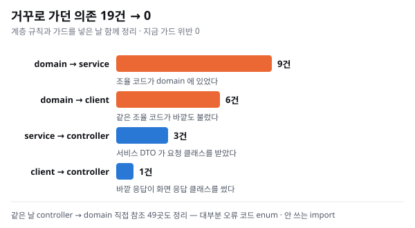

> **어드민 서버 아키텍처 시리즈**
> [① 의존은 아래로만](../admin-server-architecture-1-one-way/) · ② 어긋난 의존과 고친 것 (이 글) · [③ 규칙 0개에서 가드까지](../admin-server-architecture-3-how-we-moved/)

## 한 줄로

**규칙이 없던 때 어드민 서버에는 거꾸로 가는 의존 19건과, controller 가 domain 을 바로 쓰는 곳 49곳이 있었습니다.** 둘 다 같은 날 정리했고, 지금 가드 위반은 0건입니다. 그 과정에서 «안 지켜서 생긴 비용» 이 무엇인지 숫자로 남았습니다. 이 저장소는 AI 에이전트가 코드를 많이 쓰는 곳이라, 지금은 규칙으로 막아 둡니다.

[①편](../admin-server-architecture-1-one-way/) 에서 본 규칙(의존은 아래로만, DTO 변환은 controller 쪽)은 처음부터 있던 것이 아닙니다. 아래 사례를 정리하면서 생겼습니다.

## 거꾸로 가던 의존 19건



| 종류 | 왜 생겼나 | 무엇으로 바꿨나 |
| --- | --- | --- |
| domain → service 9 · domain → client 6 | domain 패키지에 있던 클래스가 실제로는 여러 서비스와 바깥 호출을 엮는 **조율 코드** 였다(회원 탈퇴 처리, 소셜 로그인 사용자 정보 만들기) | 로직은 그대로 두고 service 패키지로 옮겼다. «조율 코드는 service 에» 라는 규칙이 이때 생겼다 |
| service → controller 3 | 서비스 DTO 의 생성자가 controller 요청 객체를 받았다 | 요청 클래스에 `to…DTO()` 를 두었다. 쓰는 곳이 없던 생성자 하나는 지웠다 |
| client → controller 1 | 바깥 서비스의 응답 모양이 같다는 이유로 화면 응답 클래스를 재사용했다 | client 쪽에 같은 모양의 응답 클래스를 따로 두었다 |

가장 많은 15건은 클래스 하나의 **자리** 문제였습니다. 이름이 `…Manager` 인 회원 탈퇴 처리 클래스가 domain 에 있으면서 서비스 여러 개와 바깥 client 를 불렀습니다. 코드를 바꿀 필요는 없었습니다. 그 일이 원래 있어야 할 계층으로 옮기기만 하면 됐습니다.

## controller 가 domain 을 바로 쓰던 49곳

같은 날 더 큰 정리가 있었습니다. 저는 «controller 가 domain 을 직접 import 하는 건 전부 금지하고, 이번에 정리하자» 고 정했습니다. import 문장으로 43건, 와일드카드까지 치면 49곳이었습니다.

들여다보니 실제로 domain 타입을 쓴 곳은 다섯 곳뿐이었습니다.

- 쓰지 않는 import 가 약 12곳이었습니다.
- 약 30곳은 API 문서(Swagger)에 오류 코드를 적으려고 domain 의 오류 코드 enum 을 가져다 쓴 것이었습니다.
- 나머지는 회원 상태 enum 을 화면 응답에서 직접 비교하는 것 같은 곳이었습니다.

그래서 오류 코드와 예외 25개 파일을 domain 밖의 **exception 잎** 으로 옮겼습니다. [①편](../admin-server-architecture-1-one-way/) 그림에서 아무도 부르지 않는 잎이 이것입니다. 회원 상태 비교는 서비스 DTO 의 메서드(`hasStatusMember()`)로 바꿨습니다.

이 정리 하나에 **174개 파일** 이 바뀌었습니다. 대부분 import 한 줄이었지만, 오류 코드를 쓰던 곳이 그만큼 퍼져 있었다는 뜻입니다. 규칙이 처음부터 있었다면 한 줄씩 막혔을 것을, 미뤄 둔 만큼 한꺼번에 치렀습니다.

정리하는 동안 생긴 일도 하나 있습니다. 대소문자만 다른 패키지 이름이 섞여 있었는데, macOS 파일 시스템이 대소문자를 가리지 않아서 그동안 빌드가 돌고 있었습니다. 같이 바로잡았습니다.

## DTO 를 다른 계층에서 재활용하면

사례 가운데 «DTO 재활용» 이 둘입니다.

**서비스 DTO 가 요청 객체를 받은 경우.** 실제 장애로 이어진 기록은 없습니다. 문제는 구조였습니다. 정리할 때 AI 에이전트가 생성자를 쓰는 곳을 검색했는데, 괄호 앞에 공백이 있는 호출(`new …DTO (`)을 놓쳤고 컴파일러가 잡았습니다. 다른 계층의 타입을 받는 생성자는 쓰는 곳을 찾기도 어렵다는 작은 단서입니다.

**바깥 응답이 화면 응답 클래스를 쓴 경우.** 다른 서비스에서 받는 응답의 일부가 이 서버의 화면 응답과 모양이 같아서 같은 클래스를 썼습니다. 그러면 화면 응답을 고치는 순간 바깥 서비스와의 계약도 같이 바뀝니다. 이것도 실제 장애 기록은 없습니다. 하지만 «모양이 같다» 는 이유로 묶은 두 계약은, 한쪽만 바뀌어야 할 때 반드시 부딪힙니다.

솔직히 이런 것은 리뷰에서 보였어도 그냥 넘어가곤 했습니다. 왜 안 되는지 설명하기 어렵고, 논쟁하고 싶지 않아서였습니다. 그렇게 넘어간 것들이 위의 19건과 49곳으로 쌓였다고 봅니다. 설명 대신 규칙과 가드가 막게 한 것이 [③편](../admin-server-architecture-3-how-we-moved/) 의 이야기입니다.

## 엔티티가 «부분 수정» 을 몰랐다

계층 방향과는 다른 종류의 사례도 하나 있습니다. 웹 어드민에서 활성 기능의 제목이나 레벨만 고치고 이미지를 다시 고르지 않으면, 저장된 이미지(thumbnail)가 **비어 버렸습니다.** 그러면 앱과 다른 서비스가 보여 주는 이미지도 함께 빕니다.

원인은 세 곳이 맞물린 데 있었습니다.

1. 웹 어드민은 이미지를 새로 골랐을 때만 요청에 붙입니다.
2. 서비스는 파일이 없으면 이미지 주소로 `null` 을 냅니다.
3. 엔티티의 `update` 는 받은 값을 그대로 덮었습니다.

```java
// 전 — null 이어도 그대로 덮는다
this.thumbnail = thumbnail;

// 후 — 보내지 않으면 기존 값을 유지한다
if (StringUtils.isNotEmpty(thumbnail)) {
    this.thumbnail = thumbnail;
}
```

엔티티가 «전체 바꾸기» 만 알고 «안 보냄 = 유지» 라는 부분 수정의 뜻을 몰랐던 것입니다. [①편](../admin-server-architecture-1-one-way/) 에서 말한 «행위의 상당수가 필드 덮어쓰기» 가 실제 버그가 된 경우입니다.

이 버그는 찾자마자 고치지 않았습니다. 이 이미지의 원본이 어느 서비스에 있어야 하는지가 먼저 정해져야 했기 때문입니다. 원본을 다른 서비스로 정하고 그 계약과 맞춘 뒤에 고쳤고, 이 필드는 사라질 필드로 표시했습니다. 같은 메서드의 다른 필드(prefix)도 같은 꼴이어서 뒤이어 고쳤습니다. 다른 엔티티에도 이미지 · 파일 주소를 조건 없이 덮는 메서드가 몇 군데 보이지만, 실제로 `null` 이 들어올 수 있는지는 아직 확인하지 않았습니다.

## 같은 날 넣고 되돌린 추상화

반대 방향의 사례도 있습니다. 2024년 말, 로그인 사용자를 만드는 코드는 username 앞머리(소셜 · 일반 · 관리자)로 `if` 를 세 번 나눠 처리했습니다. 이것을 인터페이스 + 구현 셋 + 레지스트리(전략 패턴)로 바꾼 커밋이 있고, **같은 날 48분 뒤에 되돌린 커밋** 이 있습니다.

왜 되돌렸는지는 기록에 없습니다. 커밋 메시지에 이유가 비어 있습니다. 그래서 이유를 지어 쓰지는 않겠습니다. 분기가 셋뿐인 곳에 추상화를 얹었다가 제거했습니다. 지금도 그 `if` 세 분기가 그대로 남아 있습니다.

## 정리

- 거꾸로 가던 의존 19건 중 15건은 **조율 코드의 자리** 문제였습니다. 로직은 그대로 두고 계층만 옮겼습니다.
- controller → domain 49곳을 정리하는 데 **174개 파일** 이 바뀌었습니다. 오류 코드는 아무도 부르지 않는 잎으로 뺐습니다.
- DTO 를 다른 계층에서 재활용한 곳은 장애 기록은 없지만, 두 계약을 한 클래스에 묶습니다.
- 엔티티가 부분 수정의 뜻을 몰라 이미지가 지워졌습니다. 고치기 전에 그 데이터의 원본이 어디인지부터 정했습니다.

다음 편에서는 이 정리가 어떻게 시작됐는지 봅니다. 규칙 문서에 규칙이 하나도 없던 날부터, 빌드 전에 도는 가드가 생기기까지입니다.

[③ 규칙 0개에서 가드까지 →](../admin-server-architecture-3-how-we-moved/)
