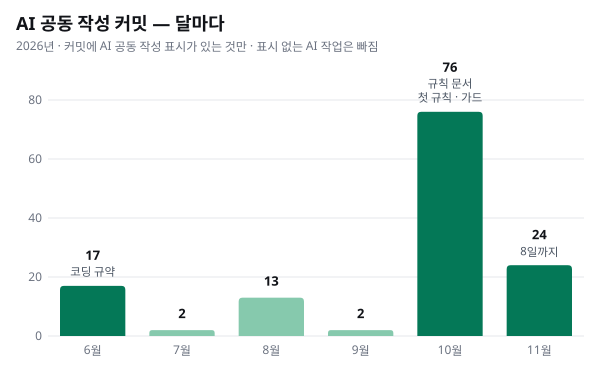

> **어드민 서버 아키텍처 시리즈**
> [① 의존은 아래로만](../admin-server-architecture-1-one-way/) · [② 어긋난 의존과 고친 것](../admin-server-architecture-2-what-went-wrong/) · ③ 규칙 0개에서 가드까지 (이 글)

## 한 줄로

**어드민 서버의 규칙 문서는 한동안 뼈대만 있고 규칙이 0개였습니다.** 첫 규칙(의존은 아래로만)은 그것을 지키는 가드와 같은 날 들어왔고, 그날 거꾸로 가던 의존을 모두 정리했습니다. 규칙만 있고 가드가 없으면 AI 에이전트는 규칙을 모르는 것과 같습니다.

## AI 가 코드를 쓰기 시작했다

어드민 서버의 전체 커밋 2,436개 중 AI 공동 작성 표시가 있는 것은 134개입니다. 표시 없이 한 AI 작업은 이 셈에 들어가지 않으니, 적어도 134개입니다. 첫 AI 커밋은 2026년 6월이고, 같은 날 코딩 규약 문서(AGENTS.md)가 들어왔습니다. AI 에게 일을 시키려면 무엇이든 적어 줘야 했기 때문입니다.

하지만 코딩 규약은 «이렇게 쓰자» 였지 «이것은 안 된다» 가 아니었습니다. 계층 방향 같은 구조 규칙은 없었습니다.

## 뼈대만 있던 규칙 문서

10월 초에 규칙 문서의 뼈대가 생겼습니다. 규칙 문서(RULES.md), 작업 흐름, 개정 절차, 첫 결정 기록이 한꺼번에 들어왔습니다. 그런데 규칙 문서 안에는 **규칙이 하나도 없었습니다.** 팀 공통 규칙을 관리하는 쪽의 점검에서도 «빈 뼈대 · 규칙 0» 으로 판정됐습니다.

그사이 AI 에이전트는 계속 코드를 썼습니다. 지켜야 할 규칙이 없으니 지키지 않을 것도 없었습니다. [②편](../admin-server-architecture-2-what-went-wrong/) 에서 본 거꾸로 가는 의존 19건과 controller → domain 49곳은 이렇게 쌓였습니다. 이것을 알게 된 날 제 반응은 «아주 큰일이 났다» 였습니다. 규칙 문서는 있는데 안에 아무것도 없으니, 에이전트가 무엇을 지켜야 하는지 모르고 일하고 있었던 것입니다.

## 첫 규칙과 가드를 같은 날

그날 들어온 것은 셋입니다.

1. **첫 규칙** — 계층 의존은 아래로만 갑니다. DTO 변환은 controller 쪽, 조율 코드는 service 에 둡니다.
2. **가드** — 이 규칙을 기계로 검사하는 스크립트입니다.
3. **정리** — 가드가 잡은 위반을 그날 모두 고쳤습니다.

순서가 중요했습니다. 규칙만 넣으면 지금 있는 위반 때문에 가드가 첫날부터 빨간불입니다. 가드만 넣으면 무엇을 지키라는지 근거가 없습니다. 그래서 규칙 · 가드 · 정리를 한 번에 넣어, **들어온 순간부터 위반 0** 인 상태로 시작했습니다. 정리는 커밋 셋으로 나눴고, 각각 21 · 174 · 4개 파일이 바뀌었습니다. 세 커밋 모두 AI 공동 작성입니다.

### 가드가 하는 일

가드는 파이썬 스크립트 하나입니다.

- 파일 경로의 계층 이름(controller · service · repository · domain …)으로 각 파일의 계층을 정합니다. 패키지 이름의 오타(`contoller` · `respository`)도 같은 계층으로 읽습니다.
- import 문장과 본문의 전체 이름 참조를 텍스트로 읽습니다. 주석과 문자열은 지우고 읽습니다.
- 금지 쌍 16개(위로 가는 의존, controller → repository · domain, 잎 → 계층 등)에 걸리면 실패합니다.
- 검사할 파일이 0개면 «통과» 가 아니라 따로 실패로 칩니다. 경로가 바뀌어 아무것도 안 읽고 초록불이 되는 것을 막기 위해서입니다.

로컬 CI 는 빌드보다 이 가드를 먼저 부릅니다. 지금 기준으로 1,321개 파일의 참조 2,837개를 읽고 위반 0을 냅니다. 일부러 domain 에서 controller 를 import 하는 파일을 넣으면 위반 1로 실패하는 것도 확인했습니다. 가드는 **실제로 실패할 수 있어야** 의미가 있습니다.

### 왜 ArchUnit 대신 텍스트 가드인가

이런 검사는 보통 ArchUnit 같은 테스트 라이브러리로 합니다. 이 안도 검토했지만 고르지 않았습니다. 의존성이 하나 늘고, 검사가 테스트 단계에 묶여 빌드가 끝나야 돌기 때문입니다. 텍스트 가드는 빌드 없이 몇 초면 돌고, AI 에이전트가 고친 직후 바로 돌려 볼 수 있습니다.

대가도 적어 두었습니다. 텍스트로 읽으니 같은 패키지 안의 참조나 리플렉션은 못 잽니다. «이 로직이 service 에 맞나» 같은 계층 안의 판단도 가드가 아니라 리뷰 몫입니다. 가드는 방향만 지킵니다.

## 아직 남은 빈칸

[①편](../admin-server-architecture-1-one-way/) 에서 말한 빈칸 둘은 그대로입니다.

- **usecase 와 service 의 경계** — 서비스 구현 70개 중 35개가 repository 를 바로 부르고, usecase 를 거치는 길과 섞여 있습니다.
- **애그리거트 · 값 객체 규칙** — 결정 기록이 없어서 규칙 문서에 넣지 않았습니다.

첫째 빈칸은 위에서부터 채워지고 있습니다. 팀 공통 규칙에서 «usecase 는 Entity · VO 만 다루고, 저장소 · 트랜잭션 · 바깥 호출은 응용 계층이 맡는다» 로 정의를 좁히는 개정이 진행 중입니다. 다른 서비스가 먼저 반영하고, 어드민 서버는 그다음 차례입니다. 지금 이 서버의 usecase 구현 25개 가운데 23개가 repository 를 import 하고 있으니, 차례가 오면 옮길 것이 꽤 있습니다.

빈칸을 남겨 둔 것은 게을러서가 아니라 순서 때문입니다. 정하지 않은 것을 규칙 문서에 지어 넣으면, AI 에이전트는 그것을 정해진 규칙으로 읽고 그대로 퍼뜨립니다. 정한 것만 적고, 정한 것은 가드로 지킵니다.

## 시리즈를 마치며

- 어드민 서버는 controller → service → repository → domain **한 방향** 계층입니다([①](../admin-server-architecture-1-one-way/)).
- 규칙이 없던 동안 거꾸로 가는 의존 19건과 controller → domain 49곳이 쌓였고, 정리에 174개 파일이 들었습니다([②](../admin-server-architecture-2-what-went-wrong/)).
- 첫 규칙은 **가드 · 정리와 같은 날** 들어와, 들어온 순간부터 위반 0이었습니다. 정하지 않은 것은 빈칸으로 둡니다.

AI 에이전트와 함께 일하는 방식 전체는 [백엔드 워크플로우 적용기](../backend-workflow-adoption/) 에, 왜 이런 구조가 AI 시대에 더 필요한지는 [왜 아키텍처인가](../why-architecture-in-ai-era/) 에 있습니다.
