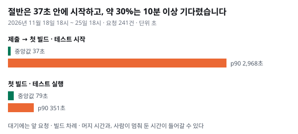
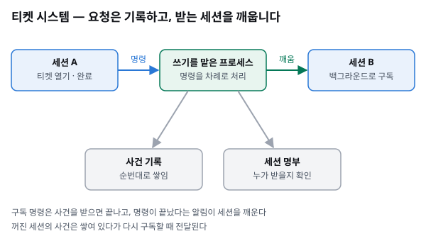
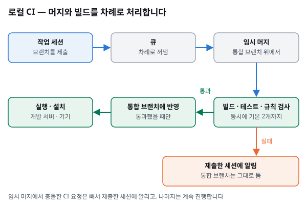

> **함께 읽으면 좋은 글**
> 에이전트와 일하는 방식은 [셋이 남았을 때](../business-flow-story/) 글에, 그 방식을 저장소에 도입하는 순서는 [Business Flow 를 내 저장소에](../business-flow-adoption-guide/) 글에 있습니다. 이 글만 읽어도 이해할 수 있게 썼습니다.

## 한 줄로

AI 에이전트 세션을 여러 개로 늘렸을 때 우리 팀이 먼저 부딪힌 것은 **토큰 한도**와 **개인 지급된 노트북 각 한 대**였습니다. 한도를 다 쓰면 여러 세션이 거의 동시에 오류를 받았고, 빌드와 테스트는 노트북 한 대에서 차례를 기다렸습니다. 우리는 세션 사이의 요청을 티켓 시스템에 기록해 주고받고, 머지와 빌드는 로컬 CI 로 종류별로 하나씩 차례로 처리합니다. 이렇게 해도 한도와 메모리가 늘어나지는 않고, 전후를 같은 조건으로 비교한 기록도 없습니다. 이 글은 해결 사례가 아니라, 무엇이 부족했고 지금 어떻게 처리하는지 적은 기록입니다.

## 우리는 노트북 한 대에서 이렇게 돌립니다

이 글에서 세션은 AI 에이전트와 나누는 대화 하나를 말합니다. 저장소마다 일을 나누고 확인하는 **Supervisor(감독) 세션**이 있고, 그 아래에 실제로 코드나 글을 고치는 **작업 세션**이 있습니다. 작업 세션은 저장소 하나를 브랜치별 작업 폴더(git worktree)로 나눠, 폴더마다 따로 일합니다.

모델은 외부 서버에서 돌지만 에이전트 프로세스, 빌드, 테스트, 개발 서버는 모두 개발자의 노트북에서 돌아갑니다. 2026년 11월 25일 저녁에 확인한 상태는 아래와 같습니다.

| 항목 | 값 | 확인한 방법 |
| --- | --- | --- |
| 노트북 | MacBook Air · Apple M3 · CPU 코어 8개 · 메모리 24 GiB | `sysctl` (18:38) |
| 부하 평균(load average, 1분 · 5분 · 15분) | 235 · 278 · 268 | `uptime` (18:38) |
| 스왑 | 전체 20.0 GiB 중 19.4 GiB 사용 | `sysctl vm.swapusage` (18:38) |
| 에이전트 프로세스 | 59개 | `ps` (18:38) |
| 세션이 배정된 역할 | 116개, 그중 Supervisor 21개 | 세션 목록 집계 (19:27) |

**세션이 배정된 역할**은 세션 목록에 올라 있는 역할 가운데 맡은 세션이 있는 역할의 수입니다. 세션 목록에는 «어떤 세션이 어떤 역할을 맡았나» 를 적어 둡니다. 쉬고 있거나 중단된 세션도 들어 있어, 그 시각에 일하던 세션 수나 에이전트 프로세스 수와는 다른 값입니다.

부하 평균은 CPU 를 쓰고 있거나 차례를 기다리는 작업의 평균 개수라서, 1분 평균 235를 코어 8개로 나누면 코어 하나에 대략 29개입니다. 어떤 작업이 얼마나 차지했는지는 나눠 보지 않았고, 한 시점의 값이라 하루 내내 이랬다는 뜻도 아닙니다.

## 첫 번째 병목 — 토큰 한도는 여러 세션이 함께 씁니다

우리가 쓰는 AI 코딩 도구에는 일정 기간에 쓸 수 있는 양이 정해져 있습니다. 같은 계정으로 연 세션은 이 한도를 함께 쓰기 때문에, 한도를 다 쓰면 여러 세션이 비슷한 시각에 오류를 받습니다.

세션 수는 쉽게 늘릴 수 있어도, 토큰과 계정을 늘리려면 그만큼 비용이 듭니다. 그래서 한도 하나를 몇 개 세션이 나눠 쓰는지 먼저 보는 편이 낫다고 생각합니다.

중단된 세션을 재개하는 일도 따로 준비해야 합니다. 요청과 진행 상황이 대화 안에만 있으면, 재개한 세션은 어디까지 했는지부터 찾아야 합니다. 그래서 우리는 요청과 완료 기준을 대화 밖의 기록에 남겨, 세션이 그 기록을 읽고 하던 작업을 계속할 수 있게 합니다. 이 기록이 아래에서 설명할 티켓입니다.

## 두 번째 병목 — 빌드와 테스트가 노트북 한 대를 나눠 씁니다

에이전트가 코드를 고치는 속도는 세션 수만큼 늘어날 수 있지만, 고친 코드를 확인하는 노트북은 한 대입니다. Android 빌드, 서버 테스트, 웹 빌드가 겹치면 CPU 와 메모리를 나눠 쓰게 됩니다. 개발 서버의 포트와 USB 로 연결한 테스트 기기도 하나씩이라 동시에 쓸 수 없습니다.

로컬 CI 는 이 노트북에서 머지 · 빌드 · 테스트를 차례로 실행하는 도구입니다. 세션이 로컬 CI 에 브랜치를 제출하는 것을 이 글에서는 CI 요청이라고 부릅니다. 이 도구에 남은 기록으로 대기 시간을 확인했습니다. 2026년 11월 18일 18시부터 25일 18시까지 7일 동안 제출된 CI 요청 가운데 빌드 · 테스트를 실행한 것은 저장소 18개에서 241건입니다.

| 구간 | 중앙값 | p90(CI 요청의 90%가 이 시간 안) |
| --- | --- | --- |
| 제출 → 첫 번째 빌드 · 테스트 시작 | 37초 | 2,968초(약 49분) |
| 첫 번째 빌드 · 테스트 실행 | 79초 | 351초 |

절반은 37초 안에 시작했지만 241건 중 73건(약 30%)은 10분 이상 기다렸습니다. 이 대기에는 앞 CI 요청이 끝나기를 기다린 시간, 빌드 차례를 기다린 시간, 머지에 걸린 시간, 사람이 로컬 CI 를 멈춰 둔 시간이 섞여 있을 수 있습니다. 원인별로 나눠 보지 않아서, 전부 «노트북이 느려서» 생긴 대기라고 말하지는 못합니다.

저장소별로 나눠 보면 여러 세션의 작업을 합칠 때 어디서 막히는지 더 잘 보입니다. 아래는 우리 노트북의 세션을 2026년 11월 26일 12:38 에 세션 목록으로 센 값 가운데, 웹 · Android · 서버 저장소 다섯 곳만 옮긴 것입니다. CTO · 콘텐츠처럼 코드를 빌드하지 않는 저장소의 Supervisor 는 뺐습니다. 작업 세션은 지금 일을 맡은 세션이고, 상시 세션은 저장소마다 규칙 개정 · 도구 · 통합을 늘 맡아 두는 세션입니다. CI 요청 수와 대기 시간은 위 표와 같은 7일 기록입니다.

| 저장소 | 플랫폼 | 세션(Supervisor · 작업 · 상시) | CI 요청 | 제출 → 첫 번째 빌드 · 테스트 시작(중앙값 / p90) | 10분 이상 기다린 요청 |
| --- | --- | --- | --- | --- | --- |
| 관리자 웹 | 웹 | 1 · 1 · 3 | 19건 | 30초 / 742초 | 3건 |
| 앱 | Android | 1 · 6 · 3 | 74건 | 46초 / 5,232초 | 25건 |
| 서버 A | 서버 | 1 · 1 · 3 | 12건 | 43초 / 1,398초 | 2건 |
| 서버 B | 서버 | 1 · 0 · 3 | 11건 | 241초 / 1,105초 | 5건 |
| 서버 C | 서버 | 1 · 0 · 3 | 4건 | 24초 / 1,516초 | 1건 |

작업 세션이 가장 많은 앱 저장소에서 CI 요청도 가장 많았고, 10분 이상 기다린 요청도 25건으로 가장 많았습니다. Android 와 서버는 서로 동시에 실행하지 않아서 앱과 서버 세 곳의 요청이 같은 실행 차례를 기다립니다. 웹은 따로 차례를 기다리고, 10분 이상 기다린 요청은 3건이었습니다. 세션 수는 하루 뒤에 센 값이라 기록을 모은 기간의 세션 수와 다를 수 있습니다.

노트북이라서 생기는 일도 있습니다. 노트북이 잠자기에 들어가 응답이 중간에 끊겼다는 오류가 세션 기록에 남아 있습니다.

## 티켓 시스템 — 세션끼리 무엇을 주고받는지 기록합니다

우리는 세션끼리 메시지로 작업을 위임하지 않고 **티켓 시스템**에 요청을 남깁니다. 티켓에는 요청한 이유, 할 일, 완료 기준이 들어 있습니다. 받는 세션은 먼저 무엇을 위한 일인지, 완료 기준이 무엇인지, 무엇을 하지 않을지 적어 수락합니다. 일이 끝나면 결과와 확인 방법을 적어 돌려주고, 요청한 쪽이 확인해야 티켓이 닫힙니다.

일이 전달되는 순서는 아래와 같습니다.

1. 세션이 티켓 열기, 수락, 완료 같은 명령을 보냅니다.
2. 쓰기를 전담하는 프로세스 **하나**가 명령을 한 번에 하나씩, 데이터베이스 트랜잭션 하나로 처리합니다.
3. 티켓이 열렸다, 완료됐다 같은 처리 결과는 이벤트로 만들고, 순서대로 번호를 붙여 **이벤트 로그**에 쌓습니다. 이때 앞에서 말한 세션 목록을 보고 받을 세션을 정합니다.
4. 받는 세션은 백그라운드에서 **구독** 명령을 실행해 둡니다. 구독 명령은 이벤트가 올 때까지 기다리다가, 이벤트를 받으면 끝납니다. 에이전트 도구는 백그라운드 명령이 끝나면 세션에 알려 주므로, 세션은 그때 다시 일을 시작합니다.
5. 구독하지 않던 세션이 받을 이벤트는 쌓여 있다가 그 세션이 다시 구독할 때 전달됩니다.

이 방식에서는 세션이 새 일이 있는지 폴링하지 않아도 됩니다.

## 로컬 CI — 머지와 빌드를 차례로 처리합니다

세션은 저마다 다음에 할 일을 알고 있고, 문제는 여러 세션이 고친 것을 하나로 합칠 때 생깁니다. 그래서 작업 세션은 빌드를 직접 돌리지 않고 로컬 CI 에 브랜치를 제출한 다음, 결과가 나오는 동안 다른 작업을 계속합니다. CI 요청은 큐에 쌓이고, 로컬 CI 는 Android · 서버 · 웹 등 종류별로 한 번에 하나씩 꺼냅니다. CPU 를 많이 쓰는 Android 와 서버는 서로 동시에 실행하지 않습니다.

- **머지** — 여러 작업을 모으는 통합 브랜치에 임시로 머지한 상태에서 빌드 · 테스트 · 규칙 검사를 하고, 통과해야 통합 브랜치에 반영합니다.
- **실패** — 원인부터 구분합니다. 재현 방법을 정해 둔 저장소는 실패한 테스트만 다시 실행해 봅니다. 재현되지 않으면 제출한 브랜치 때문이라고 보지 않고 빌드 · 테스트를 다시 실행합니다. 이어서 브랜치를 머지하기 전에도 실패하는지 확인하고, 실패하면 기존 문제로 봅니다.
- **충돌** — 충돌한 CI 요청만 뺍니다. 나머지 CI 요청은 계속 진행하고, 충돌은 제출한 세션이 자기 작업 폴더에서 해결합니다.
- **동시 빌드** — 기본 2개까지입니다. 첫 번째는 바로 시작하고, 두 번째는 남은 메모리가 예상 사용량 이상일 때만 시작합니다. 예상 사용량은 기본값(저장소 설정에 값이 있으면 그 값, 없으면 종류별 값)과 최근 실제 최대 사용량 중 큰 값입니다.
- **스왑** — 상한을 2개로 정할 무렵(2026년 11월 11일)의 기록에는 스왑 18.4 GB 중 18.0 GB 를 쓰고 있었다고 적혀 있습니다.

## 그래도 남는 것

차례로 처리하면 기다리는 시간이 생깁니다. 앞에서 본 것처럼 약 30%는 10분 이상 기다렸습니다. 티켓 시스템과 로컬 CI 를 쓰면서 시간과 토큰이 얼마나 줄었는지는 따로 측정해 두지 않았습니다.

도구를 관리하는 일도 늘었습니다. 구독이 끊기면 세션이 다시 시작하지 않아, 세션이 멈추기 전에 구독 중인지 확인하는 훅을 추가했습니다. 훅은 에이전트 도구가 정해진 시점에 자동으로 실행하는 스크립트입니다.

## 스타트업이라면 먼저 볼 것

우리가 다시 시작한다면 아래 순서로 볼 것 같습니다. 우리 팀 한 곳의 경험에서 나온 판단이고, 다른 팀에서 확인한 순서는 아닙니다.

1. **계정과 한도** — 세션을 늘리기 전에 같은 한도를 몇 개 세션이 나눠 쓰는지 적어 봅니다.
2. **동시 빌드 수** — 노트북 메모리로 동시에 몇 개를 빌드할 수 있는지 확인하고 상한을 둡니다. 큐가 없어도 상한은 둘 수 있습니다.
3. **요청 기록** — 세션이 중단됐다가 재개돼도 읽을 수 있는 곳에 요청과 완료 기준을 적습니다. 처음에는 이슈 트래커여도 됩니다.
4. **세션 수** — 위 항목을 확인한 뒤에 늘립니다.
