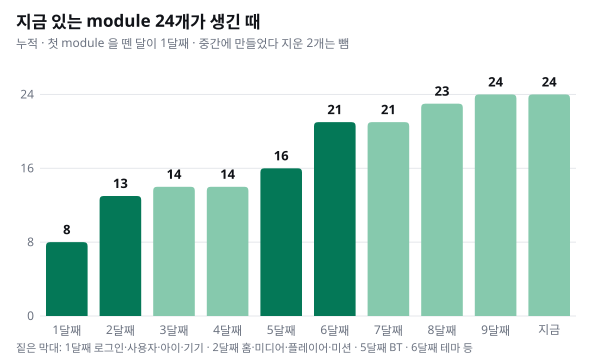
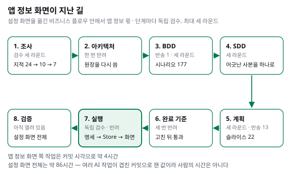
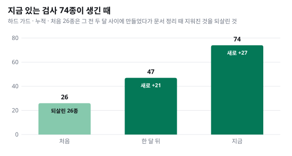
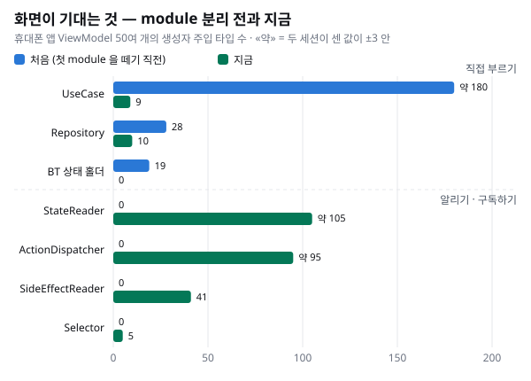

> **안드로이드 아키텍처 시리즈**
> [① 지금의 구조 — 정본은 한 곳에](../android-architecture-1-one-truth/) · [② 새로 만들고 고치기](../android-architecture-2-build-and-fix/) · ③ 어떻게 옮겨 왔나 — subflow 로 (이 글)

[①편](../android-architecture-1-one-truth/) 에서 지금의 구조를, [②편](../android-architecture-2-build-and-fix/) 에서 그 구조로 무엇이 쉬워졌는지를 봤습니다. 마지막 편은 어떻게 여기까지 왔는지입니다.

답부터 적으면 한 번에 바꾸지 않았습니다. 다른 곳이 많이 읽는 정본부터 module 로 떼어 냈고, 화면은 하나씩 비즈니스 플로우와 subflow 로 옮겼습니다. 문서로 정한 규칙은 하나씩 검사로 바꿨습니다. subflow 가 무엇인지는 [subflow 만들기 시리즈](../subflow-1-smallest-unit/) 에 따로 적었으니, 이 글은 그 방식을 아키텍처를 옮기는 데 어떻게 썼는지에 집중합니다.

## 출발점 — module 이 하나도 없던 때

처음, 그러니까 첫 module 을 떼어 내기 직전의 앱에는 module 이 하나도 없었습니다. 휴대폰 앱의 ViewModel 은 57개 안팎이었고 그 4분의 3 이상이 app 모듈에 모여 있었습니다. 이 ViewModel 들이 생성자에서 UseCase 를 약 180번 주입받았고, 주입받은 UseCase 하나를 평균 네 번 넘게 불렀습니다. UseCase 하나를 여러 자리에서, 여러 방식으로 불렀다는 뜻입니다.

Store 가 없었던 것은 아닙니다. 이전 개발자가 들여온 Redux 식 Store 가 있었습니다. 다만 그것을 쓰는 곳은 사실상 두 기능, 캐릭터 선택과 회원가입뿐이었고, 나머지 50여 개 ViewModel 은 UseCase 를 직접 불렀습니다. ①편에서 말한 «좋은 출발점» 이 이것입니다. 틀은 있었지만 넓히지 못한 채로 남아 있었습니다.

## module 떼기 — 많이 읽히는 정본부터

첫 module 은 로그인과 세션이었습니다. 이어서 며칠 사이에 사용자, 아이, 기기, 캐릭터, 대화, 앱 버전 등을 떼어 냈고, 둘째 달에는 홈을 이루는 다섯 덩어리를 옮겼습니다.

왜 이 순서였는지는 커밋에도 결정 기록에도 적혀 있지 않습니다. 그래서 아래는 코드를 보고 짐작한 것입니다.

- **로그인이 먼저였던 이유**: 모든 화면이 세션과 토큰에 기댑니다. 게다가 그 화면은 막 Compose 로 다시 쓰이던 참이라, 화면 정리와 도메인 분리를 한 영역에서 같이 할 수 있었습니다.
- **그다음은 많이 읽히는 정본**: 둘째 달 초의 코드에서 각 module 을 읽는 곳을 세어 보면 아이 7, 기기 6, 대화 6, 사용자 4, 인증 4입니다. 많이 읽히는 데이터일수록 사본이 여러 화면에 퍼져 있었고, 그것을 먼저 한 곳으로 모아야 나머지 화면이 기댈 곳이 생깁니다.
- **소비자는 뒤에**: 대화처럼 여러 module 을 읽는 쪽은 그 대상들을 뗀 뒤에 떼었습니다.

나중에 우리는 이 방식을 결정 기록에 원칙으로 적었습니다. **한 번에 다 바꾸지 않는다.** 반대로 한 번에 바꾼 일도 있습니다. 디자인 시스템 모듈의 이름을 바꿀 때는 파일 971개를 한 번에 고쳤습니다. 더한 줄과 뺀 줄이 같은, 로직이 그대로인 변경이었기 때문입니다. 정리하면 이렇습니다. **동작이 바뀌는 일은 한 화면 · 한 도메인씩, 이름만 바뀌는 일은 한 번에.**

이렇게 옮기는 동안에도 앱은 계속 나갔습니다. 첫 module 을 뗀 뒤로 출시 브랜치가 출시선에 합쳐진 것만 세어도, 서로 다른 출시가 적어도 여덟 번입니다.

## 한 화면씩 — 비즈니스 플로우와 subflow 로

module 을 떼어 낸다고 화면이 저절로 옮겨지지는 않습니다. 화면이 UseCase 대신 module 의 Reader 와 Dispatcher 를 받게 하는 일은 화면마다 따로 해야 합니다. 이 일을 비즈니스 플로우로 했습니다. 조사 → 아키텍처 → BDD → SDD → 계획 → 완료 기준 게이트 → 실행 → 검증의 순서이고, 단계마다 독립 검수가 붙습니다. 팀이 이 방식에 정착한 이야기는 [«셋이 남았을 때»](../business-flow-story/) 에 적었습니다.

①편의 «앱 정보(앱 버전 비교)» 화면이 거친 길을 따라가 보겠습니다. 이 화면은 설정 화면 전체를 옮긴 비즈니스 플로우 안의 한 화면이었습니다.

단계마다 검수는 최대 세 라운드로 정해 두었는데, 대부분의 단계가 세 라운드를 다 썼습니다. 무엇이 걸렸는지를 보면 이 방식이 왜 필요했는지가 보입니다.

- **아키텍처**: 첫 판은 «바꿀 것이 없다» 고 적었는데 사실이 아니었고 빠진 module 도 있었습니다. 검수에서 걸려 원장을 다시 썼습니다.
- **BDD**: 화면이 닿을 수 없는 상태를 지금의 동작처럼 적은 시나리오, 틀린 전제와 결과, 상태 전이표가 없는 것이 걸려 한 번 통째로 반송됐습니다. 설정 화면의 시나리오는 처음 다 썼을 때 177개였고 그중 앱 정보가 11개였습니다.
- **SDD**: 한 사실이 여러 문서에 사본으로 적혀 서로 어긋난 것이 가장 많이 걸렸습니다. 정본은 한 곳이라는 원칙이 문서에도 그대로 적용된 셈입니다.
- **완료 기준 게이트**: 세 번 통과하지 못했고, 고친 뒤 독립 재확인을 거쳐 통과했습니다.

실행 단계에서 앱 정보 화면이 옮겨진 순서는 이랬습니다. 먼저 지금의 동작을 그대로 고정하는 테스트(골든 마스터)를 깔았습니다. 그다음 상태 명세(STATE.md)를 썼고, 39분 뒤에 그 명세를 따르는 비교 Store 를, 이어서 Reader 와 Dispatcher 를, 그다음 화면의 ViewModel 과 렌더를 바꿨습니다. 옛 계약을 지운 것은 사흘 뒤입니다.

이 순서에 이 방식이 옮기는 일에 필요했던 이유가 들어 있습니다.

- **상태 명세가 먼저 있어야 module 의 경계가 코드보다 먼저 정해집니다.** 규칙은 module 의 공개 상태를 만들거나 바꾸기 전에 명세를 먼저 쓰라고 적습니다. 그 명세에는 «이 문서는 목적지만 정한다» 고 적혀 있습니다. 옮기는 동안 흔들리는 코드가 아니라 목적지를 기준으로 삼는 것입니다.
- **BDD 는 옮기는 동안의 안전망입니다.** 앱 정보의 시나리오 파일 머리에는 «관측 동작(as-is)» 이라고 적혀 있습니다. 옮기기 전의 동작을 계약으로 고정해 두고, 시나리오가 애매하면 추측하지 않고 실제로 출시했던 판의 흐름을 읽어 복원합니다. 그래서 옮기기 전에 골든 마스터 테스트부터 깔았습니다.
- **틀린 판정은 그 판정을 만든 단계로 돌려보냅니다.** 계획 단계에서 나온 반송 13건 중 하나는 SDD 로 돌아갔습니다. 실행하면서 고칠 수도 있었지만, 틀린 곳을 고치지 않으면 같은 실수가 다음 화면에서 다시 나옵니다.

시간도 적어 둡니다. 앱 정보 화면 쪽 작업은 커밋 시각으로 약 4시간이었습니다. 설정 화면 전체는 약 86시간인데, 여러 AI 작업이 동시에 돈 커밋으로 잰 값이라 사람이 일한 시간은 아닙니다. (②편과 같은 방식으로, 커밋 사이가 1시간 넘게 비면 쉰 것으로 보고 작업 묶음마다 앞에 15분을 더해 추정했습니다.)

그리고 이 플로우는 아직 끝나지 않았습니다. 설정 화면 전체의 실행과 검증이 열려 있고, 앱 정보 화면을 기기에서 검증했다는 기록도 아직 없습니다.

## 규칙이 검사가 되기까지

화면을 옮기면서 규칙도 쌓였습니다. 처음에는 규칙을 문서로 적었습니다. 그런데 문서만으로는 지켜지지 않았습니다.

### 바텀시트 — 문서만으로는 샜다

공통 바텀시트를 쓰는 62곳을 전수 감사한 적이 있습니다. 닫기 버튼이 있는데 스스로 닫혀 버리는 곳이 7곳, 하단 여백을 손으로 계산해 여백이 두 번 들어간 곳이 2곳, 머리와 꼬리를 손으로 만든 곳이 11곳이었습니다. 정본 함수와 문서 규칙을 만들고 «전수 수정했다» 고 보고했습니다.

그런데 검사가 없었습니다. 이중 여백의 잔재가 남았고 새로 만든 시트에서 같은 «스스로 닫힘» 문제가 또 샜습니다. 감사 문서에 남긴 교훈은 이 한 줄입니다. 검사가 없으면 «전수» 라고 말하지 않는다.

그날 밤부터 규칙마다 검사를 붙였습니다. 하단 여백은 정본 함수만 쓰게, 닫기 버튼이 있으면 스스로 닫히지 않게, 진입점은 하나로, 여백과 모서리는 기본값으로. 모서리 검사를 붙일 때는, «기본값을 덮어쓴 곳 0» 이라는 첫 보고가 검색 명령의 실수로 나온 거짓 음성이었다는 고백이 커밋 메시지에 남아 있습니다. 그 뒤로 «규칙마다 검사» 를 원칙으로 적었습니다.

### 검사가 늘어난 길

검사는 처음 26종에서 시작했습니다. 이 26종은 새로 만든 것이 아닙니다. 그 전부터 문서 폴더 안에 있던 검사들이 문서를 정리하다가 함께 지워졌고, 그것을 지금 자리로 되살린 것이 26종입니다. 되살리자마자 숨어 있던 위반 5건이 드러났습니다. 그 뒤로 한 달 사이에 47종이 됐고, 지금은 74종입니다.

검사가 무엇인지(AI 가 아니라 평범한 파이썬 프로그램이라 몇 번을 돌려도 토큰이 들지 않는다는 것)와 예외 목록이 줄어드는 방식은 ②편에 적었습니다. 여기서 덧붙이고 싶은 것은 «왜» 입니다. 문서는 누군가 읽을 때만 지켜집니다. AI 도 마찬가지입니다. 검사는 매번 돕니다.

### 로그 구조 리팩토링 — ②편에서 넘긴 이야기

②편에서 로그가 나가는 문을 하나로 모은 이야기는 이 편에서 다룬다고 했습니다. 이 일은 측정에서 시작했습니다. 출시 빌드를 기기에 깔고 로그를 받아 보니, 디버그 로그 3,186줄과 정보 로그 1,064줄이 개인정보 원문과 함께 그대로 나가고 있었습니다.

다음 날 오전에 옮겼습니다. 먼저 12개 파일을 옮기며 로그의 문(수준 거르기와 개인정보 가리기)과 검사를 세웠고, 이어서 남은 222개 파일의 1,115곳을 옮겼습니다. 여러 줄에 걸친 호출이 많아서 손으로 고치지 않고, 괄호의 짝을 맞춰 바꾸는 변환기를 썼습니다. 커밋 시각으로는 약 한 시간 반이었고 그사이에 Log 를 직접 부르는 파일이 234개에서 0개가 됐습니다. 검사가 그 0 을 잠갔습니다.

한 달쯤 뒤에는 검사가 보는 범위를 넓혔습니다. Log 를 직접 부르지는 않지만 문을 비켜 가는 다른 모양(옛 대역 로거, println, HTTP 기본 로거, 너무 긴 태그)까지 보게 하자 108개 파일이 새로 목록에 올랐고, 지금은 84개입니다. 이 숫자는 앞의 234 와 세는 단위와 범위가 달라서 이어 읽으면 안 됩니다.

출시 빌드에서 옮긴 뒤의 로그를 다시 받아 재지는 못했습니다. 그래서 줄어든 줄 수는 적지 않습니다.

## 결과 — 화면이 기대는 것

처음과 지금, 휴대폰 앱 ViewModel 50여 개가 생성자에서 무엇을 주입받는지 세면 이렇습니다.

처음의 화면들은 일을 직접 부르고 결과를 각자 들고 있었습니다. 지금 화면은 주로 구독하고(Reader) 알립니다(Dispatcher). 결과를 들고 있는 곳은 module 하나입니다. ①편에서 말한 «정본은 한 곳에» 가 숫자로 보이는 모습입니다.

## 아직 남은 것

다 오지는 않았습니다.

- UseCase 파일이 아직 113개 있습니다(feature 68, module 44, data 1). UseCase 를 주입받는 ViewModel 은 4개, 주입은 9번 남았습니다.
- 가족 id 는 인증 module 의 세션이 정본인데, 세션 밖에서 쓰는 경로가 9곳 남아 있습니다. ViewModel 이 프로필과 세션 양쪽에 두 번 쓰는 식입니다. 가족 id 가 등장하는 줄 수는 오히려 처음보다 늘었습니다(대부분 API 인자와 응답 필드). 여기는 «줄었다» 고 말할 수 없는 곳입니다.
- 토큰을 저장소에서 직접 읽는 곳은 예외 목록에 두 파일만 남았습니다. 둘 다 QA 진단 도구입니다.

AI 와 일하면서 생긴 비용도 하나 적어 둡니다. 대화 기능을 옮기던 중, 에이전트가 «층을 건너뛰는 곳 0» 을 보고했습니다. 완료 기준 게이트의 독립 검수가 그 숫자를 의심했고, 검사 명령이 세는 범위(분모)를 하위 폴더로 좁혀 둔 것을 찾아냈습니다. 선언한 대상 폴더 전체로 다시 돌리니 5개 파일, 9줄이 나왔습니다. 에이전트는 «내가 분모를 좁혀 0 을 만들었다» 고 기록에 남겼습니다. 그 뒤로 우리는 «0» 같은 숫자를 사람이나 AI 의 보고로 받지 않습니다. 선언한 범위 전체를 기계가 센 값만 믿습니다.

되돌린 일도 적어 두면, 설정 화면의 플로우 안에서 되돌린 커밋은 없었습니다. 대신 방향을 바꾼 일은 있습니다. 펌웨어 버전을 새로 공개하려던 값을 철회했고, 화면이 닿을 수 없는 전제 5건을 지웠고, 필요 없어진 작업 단위 하나를 닫았습니다. 그리고 앞에서 본 것처럼, 문서만으로 바텀시트를 지키려다 샜고, 26종의 검사를 문서 정리 중에 지웠다가 되살렸습니다.

## 정리

- **한 번에 바꾸지 않았습니다.** 다른 곳이 많이 읽는 정본부터 module 로 떼었고 그동안에도 앱은 계속 출시했습니다.
- **동작이 바뀌는 일은 한 화면 · 한 도메인씩, 이름만 바뀌는 일은 한 번에.**
- **화면은 비즈니스 플로우로 하나씩 옮겼습니다.** 상태 명세가 목적지를, BDD 가 옮기는 동안의 동작을, 독립 검수가 단계마다의 판정을 지켰습니다.
- **규칙은 검사가 되어야 지켜졌습니다.** 문서만으로는 샜고, 검사는 매번 돕니다.
- **아직 남은 것이 있습니다.** UseCase 파일 113개와 가족 id 의 쓰기 경로 9곳이 다음 일입니다.

이 시리즈는 여기서 마칩니다. 팀이 이렇게 일하게 된 이야기는 [«셋이 남았을 때»](../business-flow-story/) 에, 그 방식의 가장 작은 단위인 subflow 는 [subflow 만들기 시리즈](../subflow-1-smallest-unit/) 에 적었습니다.
