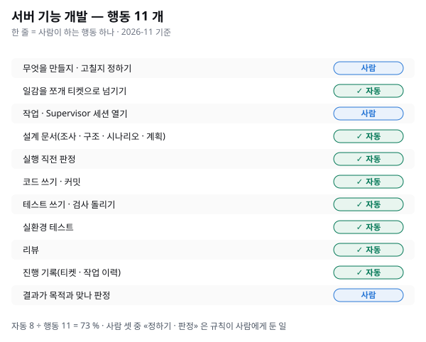
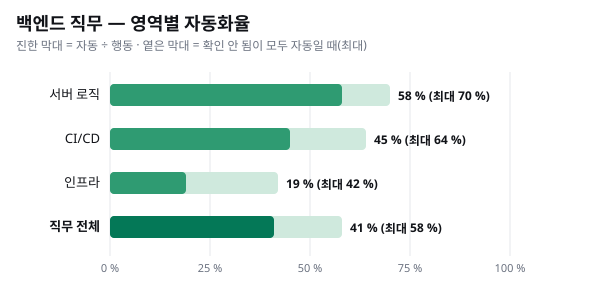
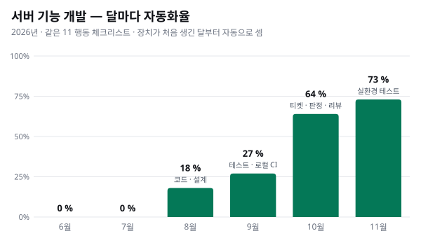

## 한 줄로

**업무를 «사람이 하는 행동» 한 줄씩으로 나누고, 행동마다 누가 하는지 매기면 업무별 자동화율이 나옵니다.** 백엔드 직무 하나를 98 개 행동으로 나눠 보니, 2026년 11월 기준 40 개(41 %)를 AI 나 기계가 사람 손 없이 합니다. 같은 체크리스트를 달마다 다시 매기면 추이가 되고, AI 전환(AX · AI Transformation)이 어디까지 왔는지 보는 지표로 쓸 수 있습니다.

## 왜 업무별로 나눠 봐야 했나

처음에는 «AI 가 얼마나 일하나» 를 여러 방법으로 파악했습니다. 커밋에 AI 공동 작성 표시가 붙은 몫, 자동화 단계(사람이 다 함 → 사람이 하지 않음) 매기기, 업계 평균 백엔드 업무 목록과의 대조, 일 한 건이 거치는 단계를 흐름도로 그려 보기였습니다.

모두 숫자나 그림은 나왔지만 질문에 답하지 못했습니다. 백엔드 코드 커밋의 95 %(90 일 966 건 중 917 건)에 AI 표시가 있어도, «그래서 배포는? 장애 대응은?» 에는 답이 없습니다. 커밋은 코드를 쓰는 일만 보여 주고, 단계 매기기는 업무 하나를 통째로 한 칸에 넣어서 그 안의 어디를 사람이 맡는지 보이지 않았습니다.

그래서 질문을 바꿨습니다. **«직무기술서의 업무마다 몇 % 가 자동인가.»** 업무를 통째로 파악하기 어려워, 더 잘게 나눠 체크리스트로 세게 되었습니다.

## 방법 — 업무를 행동으로 나눈다

### 1. 업무는 직무기술서 그대로

직무기술서에 적힌 업무 이름을 그대로 씁니다. 백엔드 직무는 업무 20 개를 세 영역으로 묶었습니다(서버 로직 7 · CI/CD 4 · 인프라 9). 웹(관리 화면)은 웹 직무로 따로 파악합니다. 새로 지어낸 분류가 아니라 이미 있는 직무기술서를 쓰는 것이 중요합니다. 그래야 «이 사람의 일 중 몇 % 가 넘어갔나» 로 읽힙니다.

### 2. 업무를 한 행동씩 나눈다

한 업무를 사람이 실제로 하는 행동 단위로 나눕니다. **한 줄 = 한 행동** 입니다. 서버 로직의 «기능 개발» 은 이렇게 열한 줄이 됩니다.

나눌 때 규칙이 하나 있습니다. **«AI 가 쓰고 사람이 승인한다» 는 두 줄입니다**(쓰기 한 줄 · 승인 한 줄). 한 줄로 묶으면 그 행동이 자동인지 사람인지 정할 수 없습니다.

### 3. 행동마다 네 항목 중 하나

| 항목 | 뜻 |
| --- | --- |
| **자동** | AI 나 기계가 사람 손 없이 한다 |
| **사람** | 사람이 하거나, 사람 입력 없이는 다음으로 넘어가지 않는다 |
| **확인 안 됨** | 누가 하는지 보일 기록을 찾지 못했다 |
| **하지 않음** | 그 행동을 하는 기록이나 장치가 없다 — 자동이 아니다 |

«확인 안 됨» 과 «하지 않음» 을 따로 두는 것이 이 방법의 핵심입니다. 기록이 없는 행동을 추측으로 자동이나 사람에 넣으면 숫자가 그럴듯해지지만 믿을 수 없게 됩니다.

### 4. 셈

- **자동화율 = 자동 행동 수 ÷ 그 업무의 행동 수**
- 확인 안 된 행동은 자동으로 치지 않습니다. 그래서 이 값은 낮게 잡은 값입니다. 대신 **확인 안 된 행동이 모두 자동일 때의 값(최대)** 을 옆에 따로 둡니다.
- 커밋으로 파악할 수 있는 행동(코드 쓰기 등)은 최근 두 달 커밋의 **80 % 이상** 에 AI 공동 작성 표시가 있으면 자동으로 셉니다. 80 % 아래면 사람으로 셉니다.
- 근거 항목을 꼭 둡니다. «최근 두 달 코드 커밋의 99 % 가 AI 표시», «잡 안의 승인 입력», «사람 확인 시트로 사람이 판정» 처럼, 그 항목을 왜 그렇게 매겼는지 한 줄씩 적습니다.

## 결과 — 백엔드 직무 41 %

| 영역 | 행동 | 자동 | 사람 | 확인 안 됨 | 하지 않음 | 자동화율 | 최대 |
| --- | --- | --- | --- | --- | --- | --- | --- |
| 서버 로직 | 40 | 23 | 11 | 5 | 1 | 58 % | 70 % |
| CI/CD | 22 | 10 | 8 | 4 | 0 | 45 % | 64 % |
| 인프라 | 36 | 7 | 15 | 8 | 6 | 19 % | 42 % |
| **직무 전체** | **98** | **40** | **34** | **17** | **7** | **41 %** | **58 %** |

같은 방법으로 웹 직무(관리 화면)를 따로 재 보니 57 % 였습니다(행동 30 중 17).

- **많이 넘어간 곳** — 코드를 쓰고, 테스트하고, 리뷰하고, 통합하는 행동입니다. 변경 통합 · 자동 검사는 100 %, 서버 기능 개발은 73 %, 결함 수정은 67 % 입니다. 사람에게 남은 행동은 **무엇을 만들지 정하기, 세션 열기, 결과 판정** 입니다.
- **적게 넘어간 곳** — 인프라가 19 % 로 가장 낮습니다. 배포 버전 기록, 원격 반영, 상위 환경 배포 승인, 클러스터 유지 보수는 사람이 맡습니다. 모니터링이나 로그 조사는 누가 하는지 기록이 없어 «확인 안 됨» 이고, 로그 파이프라인을 Claude 와 연결해 자동화하는 일은 아직 하지 않았습니다. 이 영역은 더 성숙해야 합니다. 작업을 세분화하다 보면 인증서 만료 감시처럼 아예 장치가 없는 «하지 않음» 도 찾을 수 있었습니다.

사람에게 남은 업무 영역 가운데 일부는 **일부러 사람에게 둔 것** 입니다. 무엇을 만들지 정하기와 결과가 목적과 맞나 판정하기는 회사 규칙이 사람에게 맡긴 일입니다. 그래서 자동화율의 목표가 100 % 는 아닙니다.

## 시간에 따른 변화 — 서버 기능 개발 예시

같은 체크리스트를 달마다 다시 매기면 추이가 됩니다. 가장 많이 넘어간 업무 하나(서버 로직 기능 개발 · 대표 서버)만 보면 이렇습니다.

| 달 | 자동 행동 | 자동화율 | 그달 새로 자동이 된 행동 |
| --- | --- | --- | --- |
| 6월 | 0 / 11 | 0 % | — (코드 커밋 AI 표시 68 %, 80 % 아래) |
| 7월 | 0 / 11 | 0 % | — (코드 커밋 AI 표시 33 %) |
| 8월 | 2 / 11 | 18 % | 코드 쓰기 · 커밋, 설계 문서 |
| 9월 | 3 / 11 | 27 % | 테스트 쓰기 · 검사 돌리기(로컬 CI 도입) |
| 10월 | 7 / 11 | 64 % | 일감 티켓 · 진행 기록, 실행 직전 판정, 리뷰(규칙 문서 도입) |
| 11월 | 8 / 11 | 73 % | 실환경 테스트(시나리오 테스트와 통합 API 테스트가 둘 다 갖춰짐) |

여기서 실환경 테스트는 두 단계로 돕니다. **V1** 은 작업 가지를 내 자리에서 서버로 띄우고 정상 흐름과 예외 흐름 시나리오를 돌려 봅니다. **V2** 는 dev 에 배포하면서 k6 통합 API 테스트를 돌립니다. 이 행동의 몫은 V1 과 V2 가 반씩 나눕니다. V1 시나리오는 11 월에 생겼고, 기존 기능 모두에 소급해 적용하지는 않았습니다. 대신 어떤 기능이든 손대는 순간 그 부분은 반드시 V1 시나리오로 옮겨지니, 이 행동은 자동으로 셉니다. 아직 손대지 않은 로직은 V1 밖에 있습니다. 테스트 케이스 커버리지 숫자만 파악하고 끝내는 곳도 많은데, 우리는 손대는 부분부터 실환경 시나리오로 옮기는 쪽을 택했습니다. 전체 테스트 커버리지를 100 % 로 올리는 일은 별건으로, 곧 높여 갈 예정입니다.

읽을 때 주의할 점이 있습니다. 한 행동은 **그 일을 맡는 장치가 저장소에 처음 생긴 달부터** 자동으로 셌습니다. 장치가 생긴 뒤 모든 건에 실제로 쓰였는지는 파악하지 않았습니다. 코드 쓰기만은 그달 코드 커밋의 AI 표시 몫으로 셌습니다. 남은 세 행동(무엇을 만들지 정하기 · 세션 열기 · 결과 판정)은 사람에게 둔 일입니다.

## AX 지표로 쓰기

이 체크리스트를 AX 지표로 쓴다면 아래처럼 봅니다.

- **업무별 자동화율** 을 달마다 같은 규칙으로 다시 매겨 추이로 봅니다.
- **«확인 안 됨» 을 0 으로 줄이는 것** 도 목표로 둡니다. 확인하면 그 행동이 자동이나 사람으로 갈리고, 자동화율이 오르기도 내리기도 합니다. 모르는 항목이 줄어드는 것 자체가 진전입니다.
- 목표 값은 업무마다 따로 정해야 합니다. 사람에게 둔 판정이 있어서 100 % 가 목표가 될 수는 없고, 업무마다 적정선이 다릅니다.

다른 직무에도 그대로 쓸 수 있습니다. 직무기술서가 있고, 업무를 행동으로 나눌 수 있고, 행동마다 근거를 댈 기록(커밋 · 티켓 · 파이프라인 정의 · 운영 기록)이 있으면 됩니다.

## 한계

- **나누는 단위가 값을 바꿉니다.** 같은 업무를 더 잘게 나누거나 묶으면 자동화율이 바뀝니다. 그래서 체크리스트 자체를 고정해 두고 달마다 같은 표로 다시 매겨야 추이가 의미가 있습니다.
- **업무의 시간 비중이 없습니다.** 영역 · 직무 값은 행동 수의 단순 합입니다. 10 분짜리 행동과 하루짜리 행동이 같은 무게입니다.
- **«장치가 생겼다» 와 «실제로 쓴다» 는 다릅니다.** 추이는 장치가 처음 생긴 달로 셌습니다.
- **기록 밖의 일은 보이지 않습니다.** 회의, 메신저 협의, 파이프라인 실행 기록처럼 이번에 읽지 않은 원천은 셈에 없습니다. 그래서 «확인 안 됨» 이 17 개 남았습니다.

## 정리

- 업무를 **한 행동씩** 나누고, 행동마다 **자동 · 사람 · 확인 안 됨 · 하지 않음** 중 하나를 근거와 함께 매깁니다.
- 자동화율은 **자동 ÷ 행동 수**, 확인 안 됨은 자동으로 치지 않고 **최대값** 을 따로 둡니다.
- 백엔드 직무는 **41 %(최대 58 %)**, 기능 개발 하나는 다섯 달 사이 **0 % → 73 %** 였습니다.
- 같은 체크리스트를 달마다 다시 매기면 AX 지표가 됩니다. 목표는 100 % 가 아니라, 사람에게 둘 일을 정하고 «확인 안 됨» 을 줄이는 것입니다.

AI 와 함께 일하는 방식 자체는 [백엔드 워크플로우 적용기](../backend-workflow-adoption/) 와 [Business Flow 이야기](../business-flow-story/) 에 있습니다.
