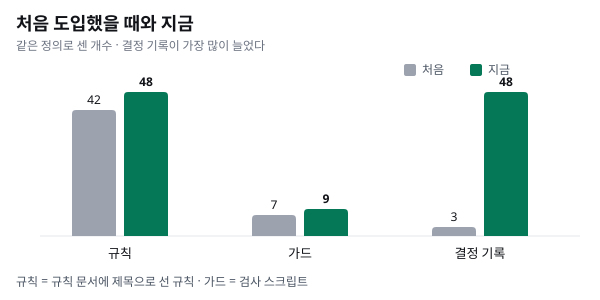
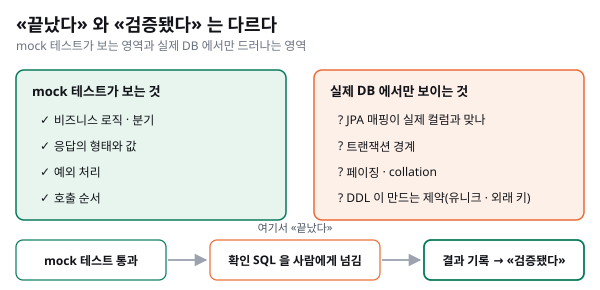
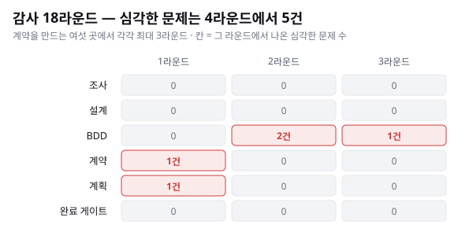

> 이 글은 [셋이 남았을 때 — 우리 팀이 Business Flow 에 정착하기까지](../business-flow-story/) 의 백엔드 편입니다. Subflow 가 무엇인지는 [Subflow 해설 ①](../subflow-guide-1-what/) 에 따로 정리했습니다.

## 한 줄로

**백엔드에서는 «테스트가 초록» 이 «안전하다» 는 뜻이 아니었습니다.** 앱에서 쓰던 작업 방식을 서버 저장소에 그대로 도입했더니 대부분은 통했지만, mock 으로는 원리상 볼 수 없는 곳이 남았습니다. 그 빈자리를 메우는 규칙을 새로 만드는 것이 백엔드 도입의 대부분이었습니다.

## 왜 백엔드에도 도입했나

앱 저장소에서는 이미 Business Flow 로 일하고 있었습니다. 일 한 건을 조사 → 설계 → BDD → 계획 → 구현 → 검증 같은 단계로 나누고, 단계마다 AI 세션이 결과물을 남기고, 다음 단계가 그것을 받아 쓰는 방식입니다. 규칙은 저장소 안의 규칙 문서에 적고, 기계로 판정할 수 있는 것은 가드(검사 스크립트)로 막습니다.

서버 저장소는 사정이 달랐습니다. 도입 직전에 남긴 기록에 따르면 이랬습니다.

- 개발 지침 문서가 main 소스의 절반쯤만 다루고 있었습니다.
- 두 모듈의 지침이 서로 반대였습니다. 한쪽은 JUnit4, 다른 쪽은 JUnit5 를 쓰라고 했습니다.
- 규칙을 기계로 판정할 수단이 하나도 없었습니다.

여기에 지금도 참인 사실이 하나 더 있습니다. **CI 가 규칙을 막아 주지 않습니다.** 한쪽은 단위 테스트를 도는 단계가 없고, 다른 쪽은 테스트가 실패해도 경고로 넘어갑니다. 정적 분석 도구도 붙어 있지 않습니다. 그래서 규칙을 지키게 하는 방법은 **저장소 안의 가드와 사람의 리뷰** 둘뿐이었습니다. 앱에서 쓰던 방식을 도입하기로 한 것은 이 두 가지를 갖추기 위해서였습니다.

## 처음 도입한 것과 지금

처음에는 규칙 문서 두 개(규칙 · 작업 흐름)와 가드 7개를 한 번에 도입했습니다. 지금까지 바뀐 양은 이렇습니다.

| 무엇 | 처음 | 지금 |
| --- | --- | --- |
| 규칙(규칙 문서에 제목으로 선 것) | 42 | 48 |
| 가드 | 7 | 9 |
| 결정 기록 | 3 | 48 |

규칙은 8개가 새로 생기고 2개가 작업 흐름 문서로 옮겨 갔습니다. 가드는 문서 정합성 가드와 API 목록 대조 가드가 늘었습니다. 이번 버전의 통합 브랜치에 들어간 서로 다른 작업 브랜치는 37개입니다.

숫자보다 눈에 띄는 것은 결정 기록입니다. 3개에서 48개가 됐습니다. 백엔드에서 새로 정해야 했던 것이 그만큼 많았다는 뜻이고, 그 대부분이 다음 절의 내용입니다.

## 백엔드라서 새로 생긴 규칙

### mock 으로 검증할 수 없는 영역은 사람이 실제 DB 로 확인한다

이 저장소는 개발 중에 실제 DB 를 붙이지 않고 mock 으로 테스트합니다. 그러면 테스트가 원리상 볼 수 없는 영역이 생깁니다.

- JPA 매핑이 실제 컬럼과 맞는지
- 트랜잭션 경계가 의도대로인지
- 페이징 · collation 이 실제 DB 에서 같은 결과를 내는지
- DDL 이 만드는 제약(유니크 · 외래 키)에 걸리는지

그래서 규칙을 이렇게 정했습니다. **mock 으로 완료를 판정하되, mock 으로 검증할 수 없는 영역은 사람이 실제 DB 에 돌릴 확인 SQL 을 남기고 넘겨야 끝난다. 결과가 기록되기 전에는 «검증됨» 이라 하지 않는다.** 앱에는 없던, 백엔드에서 처음 생긴 완료 조건입니다.

### 확인은 손으로 쓴 SQL 이 아니라 실제 읽기 경로로

앱이 «이 목록이 늘 빈 배열로 온다» 고 알려 온 일이 있었습니다. 빈 배열이 나올 수 있는 분기가 넷이었는데, AI 세션이 같은 질문에 답하는 SQL 을 손으로 다시 써서 확인했는데, 한 세션에서 그 SQL 이 실제 쿼리와 두 번 어긋났습니다. 하나는 없는 컬럼이라 바로 실패했고, 다른 하나는 조용히 다른 수를 낼 뻔했습니다. 손으로 쓴 SQL 은 API 가 실제로 타는 쿼리와 다를 수 있습니다. 그 뒤로 **확인은 그 API 가 실제로 타는 읽기 경로로 한다** 가 규칙이 됐습니다.

### DDL 스크립트는 머리에 정체를 밝힌다

릴리스 보고에서 AI 세션이 dev 에 돌릴 SQL 로 전체 스크립트와 변경분 스크립트를 함께 나열한 적이 있습니다. 전체 스크립트 머리에는 `drop table` 이 10개 있었고, 그 스크립트는 이미 dev 에 적용된 상태였습니다. 그대로 실행됐다면 운영자가 판정해 둔 데이터가 지워질 뻔했습니다.

그래서 DDL 스크립트는 머리에 **전체본인지 변경분인지, 다시 돌려도 되는지** 를 선언하게 했습니다. 이 저장소에서 DDL 은 손으로 쓴 SQL 이 유일한 원천이고, AI 에게는 «적용 대상» 이 아니라 «작성 · 리뷰 대상» 입니다.

### API 목록은 두 도구가 같은 답을 내야 한다

컨트롤러에서 엔드포인트 목록을 뽑는 도구가 둘 있었는데, 하나는 350개, 다른 하나는 335개를 냈습니다. 둘 다 틀렸습니다. 고쳐서 351개로 맞춘 뒤, 다시 어긋나면 가드가 잡게 했습니다.

### 새 API 는 자기 의미만 갖는다

옛 API 의 «NEW» 표시 규칙(시작일로 계산)이 누구의 결정도 없이 새 배지 설계 문서 네 곳(스키마 제안 · 응답 계약 · API 절 · BDD)에 차례로 굳었습니다. AI 세션은 비슷한 기능을 만들 때 옛 코드의 규칙을 그대로 가져오는 경향이 있습니다. 그래서 «새 API 는 자기 스펙이 정한 의미만 갖는다. 옛 의미를 가져오려면 사람이 정한다» 를 규칙으로 두었습니다.

### 시크릿은 규칙이 아니라 사실로 적었다

«운영 시크릿은 코드에 두지 않는다» 를 규칙으로 만들려다 그만뒀습니다. 저장소에 로컬 개발용 기본값이 있어서, 규칙으로 만드는 순간 거짓 규칙이 되기 때문입니다. 대신 «운영 값은 쿠버네티스 환경변수로 들어간다» 는 **사실** 만 적어 두었습니다. 지킬 수 없는 규칙을 세우지 않는 것도 백엔드에서 배운 판단입니다.

## 사례 — 대화 기록 조회 API 성능 개선을 처음부터 끝까지

Business Flow 한 건이 실제로 어떻게 도는지, 대화 기록을 읽는 앱 API 넷의 느린 응답을 줄이는 작업으로 보여 드리겠습니다. 응답의 모양과 값은 바꾸지 않고, 쿼리와 인덱스로 느린 응답의 비율을 낮추는 것이 목표였습니다.

**단계마다 문서가 남습니다.** 조사(현재 코드 · 소비처 · 이음새) → 설계 → BDD 시나리오 → 계약(SDD · 스키마 제안) → 계획 → 구현 → 검증 순서로, 각 단계의 결과물이 다음 단계의 입력이 됩니다.

**계약을 만드는 단계마다 독립 감사가 붙습니다.** 조사 · 설계 · BDD · 계약 · 계획 · 완료 게이트, 여섯 곳에서 각각 최대 3라운드씩, 모두 18라운드를 돌았습니다. 🔴(그대로 두면 틀린 결과가 나오는 문제)는 4라운드에서 모두 5건 나왔습니다. 하나를 예로 들면, BDD 에 «다음 쪽이 있는지 판정하는 규칙» 의 한 분기가 빠져 있어서, **틀리게 짠 구현도 테스트를 초록으로 통과하는** 상태였습니다. 감사가 그것을 찾았고, 시나리오를 더해 막았습니다.

**한 번은 앞 단계로 되돌아갔습니다.** 구현 클래스를 인터페이스 대신 직접 주입한 곳 두 군데를 «계층 위반» 으로 볼지 애매했습니다. 사용자가 «위반으로 보고 이번에 고친다» 로 정했고, 그 결정으로 조사 · 설계 결과물이 바뀌어 해당 단계 감사를 다시 돌았습니다.

**마지막 반전은 사람 쪽에서 왔습니다.** 계획은 «인덱스 DDL 은 사람이 배포 창에 적용한다» 였는데, 사용자가 운영에 같은 열의 인덱스를 먼저 적용했습니다. 사용자 쪽 측정으로는 느린 응답 비율이 먼저 내려갔습니다. 그 뒤 계획은 **체크포인트에서 «사람이 먼저 할 수 있는 몫» 을 따로 묻게** 됐습니다.

## 틀렸던 것 셋

### 1. 테스트 통과는 안전이 아니다

위 사례처럼, 테스트가 초록이어도 BDD 에 분기가 빠져 있으면 틀린 구현이 지나갑니다. 그리고 분기를 다 채워도 mock 으로 검증할 수 없는 영역은 남습니다. 그래서 «작업이 끝났다» 와 «검증됐다» 를 따로 봅니다. 확인 SQL 을 사람에게 넘기면 작업은 끝나지만, **그 결과가 기록되기 전에는 검증됐다고 하지 않습니다.**

### 2. «없음» 을 «빠뜨림» 으로 읽었다

권한 검사를 점검하던 AI 세션이 컨트롤러 30개 중 소유권 검사 표시가 없는 26개를 «검사 누락» 으로 세 번 올렸습니다. 인증과 역할은 앞단 게이트웨이가 맡고 이 서버는 소유권만 보는데, 확인할 id 를 받지 않는 엔드포인트까지 빠뜨린 것으로 읽은 것입니다. 검사가 «없는» 것이 설계인 곳을 «빠뜨린» 것으로 본 셈입니다. 지금은 인증 경계를 규칙 문서에 적어 두어, 같은 잘못이 다시 나오지 않게 했습니다.

### 3. 문서를 기준으로 점검하면 빈칸도 통과한다

규칙 문서에 «계층 구조» 를 적는 항목이 8주 동안 한 줄짜리로 비어 있었습니다. 그동안 규칙 문서 버전 업과 적합 심사를 모두 통과했습니다. 점검이 «문서에 항목이 있는가» 를 셌지, «코드가 그 항목대로인가» 를 세지 않았기 때문입니다. 지금은 **코드를 기준으로** 셉니다. 작업하는 AI 세션은 «0건 · 없다» 같은 주장을 다른 방법으로 한 번 더 확인하고, 그 결과를 다시 검증받습니다. 이 글의 숫자도 두 세션이 따로 세어 맞췄습니다.

## 대가와 남은 일

- **CI 는 여전히 규칙을 막지 못합니다.** 가드는 저장소 안에서 AI 세션과 사람이 돌릴 때만 막습니다.
- **«이미 있음» 을 400 으로 줄지 409 로 줄지가 열린 질문입니다.** 예외를 HTTP 상태로 바꾸는 표는 있고, 지금은 400 입니다.
- **가드가 막은 횟수는 셀 수 없습니다.** 판정이 어디에도 저장되지 않기 때문입니다. «가드 덕에 몇 건을 막았다» 는 숫자는 이 글에 쓰지 않았습니다.
- **되돌린 것도 있습니다.** 코드에서 나오지 않은 계층 서술을 규칙 문서에 적었다가, 제거하고 코드를 직접 세어 다시 썼습니다.
- 첫 결정 기록은 81바이트짜리 빈 껍데기로 들어갔고, 첫 결과물 전체를 나중에 검증하자 막는 것 3건을 포함해 18건이 지적됐습니다. 처음부터 완벽하게 도입하지는 못했습니다.

따로 세어 두지는 않았지만, 같은 실수가 두 번 나오는 일은 줄었다고 느낍니다. 같은 조건으로 잰 기록은 아직 없습니다.

## 정리

- 앱의 작업 방식은 백엔드에도 대부분 그대로 통했습니다. **새로 만든 것은 거의 전부 «mock 으로 검증할 수 없는 곳» 을 메우는 규칙** 이었습니다.
- 테스트가 초록이어도 안전하지 않습니다. 빠진 분기와 mock 의 사각지대를 따로 확인해야 합니다.
- 점검의 기준은 문서가 아니라 코드입니다.
