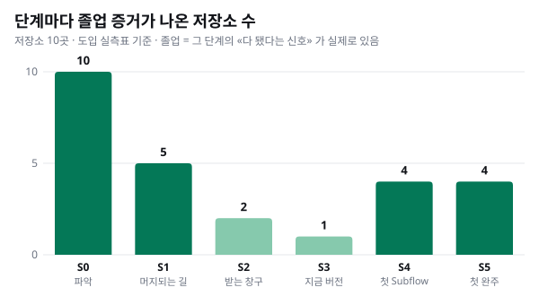

> **함께 읽으면 좋은 글**
> Business Flow 가 어떻게 생겼는지는 [셋이 남았을 때](../business-flow-story/), 가장 작은 단위인 Subflow 는 [Subflow 해설 시리즈](../subflow-guide-1-what/) 에 있습니다. 이 글은 «그래서 내 저장소에는 어떻게 도입하나» 를 다룹니다.

## 한 줄로

**Business Flow 는 공통 규칙이라는 틀 하나를 저장소마다 자기 값으로 채워서 돌립니다.** 채우는 순서는 아래와 같습니다. 저장소를 파악하고(S0), 머지되는 길을 세우고(S1), 받는 창구를 열고(S2), 지금 버전을 받고(S3), 실제 일 하나로 첫 Subflow 를 만들고(S4), 첫 Business Flow 를 끝까지 돌립니다(S5). **다음 단계는 앞 단계가 실제로 돌았다는 증거가 있을 때 엽니다.**

우리 팀은 열 곳이 넘는 저장소에서 이 방식으로 AI 에이전트와 일합니다. 저장소마다 언어도, 배포 방식도, 사람이 확인해야 하는 곳도 다릅니다. 그래도 같은 순서로 도입했습니다. 이 글은 그 순서를 처음 도입하는 사람이 따라 할 수 있게 정리한 것입니다.

## 먼저 알아 둘 것 셋

### 틀과 값 — 세 층

| 층 | 무엇을 정하나 | 예 |
| --- | --- | --- |
| **틀** | 어떤 칸이 있어야 하나 | «Business Flow 단계 표가 있어야 한다» |
| **공통 규칙** | 칸마다 모든 저장소가 갖춰야 할 최소선 | «단계는 0 sync → 조사 → 설계 → … → 검증, 빼지 않는다» |
| **저장소 규칙 문서** | 그 저장소의 값과 문장 | «완료 = 빌드 + 영향 모듈 테스트 + 가드 통과» |

공통 규칙은 **무엇을 갖춰야 하나** 만 정합니다. 완료 기준, 확인 수단, 계층 이름 같은 값은 저장소가 정합니다. 그래서 공통 규칙의 문장을 그대로 복사해 오면 칸은 채워진 것처럼 보이지만 저장소는 아무것도 정하지 않은 상태가 됩니다.

### 칸의 상태 셋

저장소 규칙 문서는 공통 규칙의 칸마다 상태를 하나 적습니다.

- **공란** — 아직 이 저장소의 값이 없습니다.
- **매핑됨** — 저장소 문서의 어느 문장이 이 칸을 채운다고 가리켜 두었습니다. 아직 심사 전입니다.
- **적합** — 심사에서 그 문장이 칸의 최소선을 채운다고 확인했습니다.

**공란은 숨기지 않습니다.** 채울 수 없는 칸은 비워 두고 왜 비었는지를 적는 편이, 짐작으로 채운 칸보다 쌉니다. 짐작으로 채운 칸은 AI 에이전트가 정해진 규칙으로 읽고 그대로 따르기 때문입니다.

### 흐름의 세 계층 — Subflow ⊂ Business Flow ⊂ Supervisor

- **Subflow** 는 결과물을 남기는 작업 한 건입니다(조사 한 축, 구현 한 조각, 게이트 한 번 실행).
- **Business Flow** 는 일 한 건의 처음부터 끝까지입니다(0 sync → 조사 → 설계 → BDD → SDD → 계획 → 완료 게이트 → 실행 → 검증). 사람이 멈춰서 확인하는 곳은 «실행 직전» 한 곳입니다.
- **Supervisor** 는 여러 Business Flow 위에서 일을 나누고, 맡기고, 지켜보고, 판정하고, 닫습니다.

## 순서대로 — 여섯 단계

원칙은 한 줄입니다. **운영 배선을 먼저 세우고, 규칙은 그 위에 얹습니다.** 규칙을 먼저 잔뜩 쓰고 배선을 나중에 두면, 규칙은 있는데 그것을 받을 자리도, 지키는지 잴 수단도 없는 상태가 오래 갑니다.

### S0. 저장소를 파악한다

| | |
| --- | --- |
| 입력 | 어떤 저장소에 도입할지(사람이 정함) |
| 할 일 | 빌드 · 테스트 · mock · 런타임 버전을 실제로 돌려 본다. 가드를 둘 자리를 정한다. **AI 에이전트가 할 수 없는 일**(사내망, 자격 증명, 운영 DB, 실기기, 배포)을 적는다 |
| 결과물 | 실측 기록 |
| 다 됐다는 신호 | 규칙 문서 폴더의 첫 커밋, 그리고 공통 규칙 쪽에 보낸 착수 알림에 적은 버전 번호 |

여기서 **들어오는 길** 을 정합니다. 길은 아래와 같고, 길마다 첫 일이 다릅니다.

| 길 | 언제 | 첫 일 | 남의 저장소를 쓰는 법 |
| --- | --- | --- | --- |
| **기존 코드** | 코드 · 데이터가 이미 있다 | 실제 코드에서 단위 · 경계 · 검증 방식을 분석한다 | 쓰지 않는다 |
| **«X 처럼»** | 비슷한 저장소가 이미 Business Flow 를 돈다 | X 의 **결정 기록**(무엇을 · 왜 · 버린 대안)을 읽고 맞는 것만 고른다 | 옮겨 온 것은 «옮겨 옴» 이라고 표시하고, 공통 규칙과 한 줄씩 대조한다. 결정은 «원본대로 · 이 저장소 사정 · 다른 저장소 선례 · 진짜로 다름» 으로 나눠, 사람에게는 «진짜로 다름» 만 묻는다 |
| **완전 새로** | 코드도 문서도 없다 | 목표 구조와 원칙을 사람과 먼저 정하고, 게이트가 초록인 상태로 규칙 문서를 시작한다 | 쓰지 않는다 |

«X 처럼» 은 셋 중 가장 쉬워 보여서 가장 조심해야 합니다. 옮겨 온 문서가 다른 저장소의 거버넌스 문장이나 계층 이름까지 끌고 오면, 이 저장소의 실제 구조가 그 밑에 묻힙니다. 계층과 역할은 항상 이 저장소의 코드를 다시 분석합니다. 옮겨 온 조각에서 공통 규칙의 필수 문장이 빠져 있거나, 없는 결정 기록을 가리킨 일이 실제로 있었습니다.

### S1. 머지되는 길을 세운다

| | |
| --- | --- |
| 입력 | S0 실측 |
| 할 일 | 규칙 문서의 머리(개정 절차 · 이력 · 결정 기록 틀 · 첫 결정 기록)를 한 묶음으로 쓴다. 통합 브랜치(`<base>/cicd`)를 base 를 품게 세우고, 브랜치 이름 셋(검수 · 통합 · 작업 시작점)을 표로 적는다 |
| 결과물 | 첫 결정 기록, 저장소 값 표 |
| 다 됐다는 신호 | 첫 결정 기록이 통합 브랜치에 **게이트가 초록인 상태로** 머지됨. `git merge-base --is-ancestor <base> <base>/cicd` 가 참 |

브랜치 이름과 머지 · push 를 누가 하는지는 **사람이 정합니다.** 에이전트는 통합 브랜치까지 머지하고, 사람이 그것을 보고 검수 브랜치로 머지합니다.

규칙 문서를 머리만 두고 **규칙이 0개인 상태를 «다 됐다» 로 세지 않습니다.** 머리는 뼈대일 뿐입니다. 계층 · 경계 같은 구조 규칙은 코드를 분석해 쓰고, 아직 분석하지 못한 범위는 «공란 + 까닭» 으로 둡니다. 그 범위의 계층은 첫 Business Flow 의 설계 단계가 그립니다.

### S2. 받는 창구를 연다 — Supervisor

| | |
| --- | --- |
| 입력 | S1 |
| 할 일 | 티켓 저장소와 세션 명부를 두고, **Supervisor 세션을 연다.** Supervisor 는 첫 턴에 열린 위임을 끝까지 읽고, 깨우는 수단과 주기를 정한다. 규칙 문서에 Supervisor 절을 쓴다 |
| 결과물 | 명부, Supervisor 이력, Supervisor 절 |
| 다 됐다는 신호 | 공통 규칙 쪽과 티켓 왕복 1회. 하루 넘게 열려 있는 위임 0 |

Supervisor 를 첫 Business Flow 보다 **먼저** 여는 데는 이유가 있습니다. Supervisor 는 여러 Business Flow 를 조정하기 전에, 먼저 **저장소가 공통 규칙의 새 버전을 받는 창구** 입니다. 창구가 없는 저장소로 보낸 개정은 받을 사람이 없어 그대로 묵습니다.

### S3. 지금 버전을 한 번에 받는다

| | |
| --- | --- |
| 입력 | S2 |
| 할 일 | 지금 공통 규칙 버전을 «지금 문면 한 장» 으로 받아, 저장소 규칙 문서와 한 번에 맞춘다. 지난 버전을 하나씩 따라가지 않는다 |
| 결과물 | 맞춤 결정 기록 |
| 다 됐다는 신호 | 수령 티켓, 결정 기록 머지, 규칙 문서가 인용하는 버전 = 지금 버전 |

### S4. 실제 일 하나로 첫 Subflow 를 만든다

| | |
| --- | --- |
| 입력 | **지금 실제로 하는 일 하나** |
| 할 일 | 그 일을 한 번 돌려 보고, 막힌 곳에 Subflow 와 규칙을 쓴다. 규칙을 하나 쓸 때마다 **그것을 집행할 수단**(게이트 · 판정 스크립트 · 가드 · git hook)을 같은 묶음에 넣는다 |
| 결과물 | Subflow 계약 표, Subflow 결과물 |
| 다 됐다는 신호 | 계약 표 1행. 새 규칙마다 집행 수단 1개. 판정 스크립트에 일부러 위반을 넣으면 실패하는 짝 테스트가 있다. **검사 대상이 0개면 통과가 아니라 실패** |

Business Flow 보다 Subflow 가 먼저입니다. 큰 흐름을 먼저 그리면 단계마다 짐작이 들어갑니다. 실제 일 하나를 돌려 보고 «이 작업은 이것을 받아서 이것을 남긴다» 를 한 행 적는 것이 출발점입니다. 계약 항목(입력 · 방법 · 결과물 · 통과 체크 · 결정 기록 · 반려되는 곳)은 [Subflow 해설 ②](../subflow-guide-2-contract/) 에 있습니다.

게이트에 대해서는 한 가지만 꼭 확인합니다. **빨간불이 나야 할 때 실제로 빨간불이 나는가.** 검사할 파일을 하나도 못 찾았는데 «위반 0» 으로 초록이 되는 게이트는 없는 것보다 나쁩니다. 일부러 규칙을 어긴 파일을 넣어 보고 실패하는지 봅니다.

코드 축의 빈칸(계층 · 경계 · 이름)은 미리 다 채우지 않습니다. 첫 Business Flow 가 거기에 부딪힐 때 닫습니다.

### S5. 첫 Business Flow 를 끝까지 돌린다

| | |
| --- | --- |
| 입력 | Subflow 둘 이상이 같은 순서로 되풀이된다 |
| 할 일 | 그 순서를 Business Flow 문서로 묶는다. 정지점은 «실행 직전» 하나. Supervisor 가 작업 하나를 맡기고(call), 지켜보고(watch), 닫는다(close) |
| 결과물 | 계획서, 계획서 끝의 Report |
| 다 됐다는 신호 | Business Flow 1회 완주. Supervisor 가 맡기고 닫은 기록 1회. 선언한 Subflow 수와 계약 표 행 수가 같은지 가드가 확인 |

### 그다음은 계기가 있을 때만

S5 다음 단계(여러 작업을 한 통합 브랜치에 줄 세우기, 작업 하나 = Business Flow 하나, Supervisor 가 여러 작업 조정, 운영 지표)는 **계기가 있을 때만** 엽니다. Business Flow 가 동시에 둘 이상 돌거나, 빌드 머신 · 테스트 기기 같은 공유 자원이 생겼을 때입니다. 계기가 없으면 «Supervisor 창구 + Business Flow 하나» 로 멈춰도 다 된 것입니다.

## 상시 고리 — 새 버전을 받는다

이 순서는 한 번 지나가면 끝이지만, 공통 규칙은 계속 바뀝니다. 그래서 새 버전을 받는 고리를 따로 돕니다.

| 단계 | 누가 | 할 일 | 다 됐다는 신호 |
| --- | --- | --- | --- |
| 0 공포 | 공통 규칙 쪽 | 새 버전과 **바뀐 행동**(이전 → 이후)을 적는다 | 공포 커밋 |
| 1 한 장 | 공통 규칙 쪽 | 여러 버전을 합친 «지금 문면 한 장», 대조할 항목 수, 저장소마다 들어갈 자리, 함정을 묶는다 | 한 장 커밋 |
| 2 위임 | 공통 규칙 쪽 | 저장소 Supervisor 마다 넘긴다. 한 장은 요약하지 않고 경로로 | Supervisor 쪽 티켓 열림 |
| 3 수령 | Supervisor | 목적 · 끝 · 하지 않을 것을 세 줄로 적고 받는다 | 수령 회신 |
| 4 대조 | 규칙 개정 작업 | 항목마다 «있다 · 일부 · 없다». 지금 구현한 버전 → 최신 버전을 **한 번에** | 표 행 수 = 대조 항목 수 |
| 5 개정 | 규칙 개정 작업 | 일부 · 없다를 그 저장소의 개정 절차로 고친다 | 심사 요청 |
| 6 심사 | 공통 규칙 쪽 | 대조와 규칙 문장을 판정한다(적합 · 조건부 · 반려) | 판정 |
| 7 머지 | 규칙 개정 작업 | 로컬 CI → 통합 브랜치에 초록으로 머지 | 통합 브랜치 커밋 |
| 8 보고 · 다시 확인 | Supervisor → 공통 규칙 쪽 | 무엇을 어떻게 했는지 보고하면, 공통 규칙 쪽이 통합 브랜치에서 다시 확인한다 | 저장소별 ✅ |

이 고리에서 지킬 점은 아래와 같습니다.

- **대조는 Supervisor 가 직접 하지 않습니다.** 늘 열려 있는 «규칙 개정 작업» 에 넘깁니다. 할지, 언제 할지를 사람에게 묻지도 않습니다. 사람에게는 규칙 문장의 뜻이 아니라 저장소의 결정만 묻습니다.
- **받았다는 회신은 끝이 아닙니다.** 통합 브랜치에 머지된 커밋, 그리고 다음 실제 작업에서 그 규칙을 지킨 기록이 있어야 끝입니다.

최근 버전(공통 규칙 0.44.0 · 11-15) 하나를 이 고리로 내렸을 때, Supervisor 열다섯 자리(저장소 열다섯 곳)가 모두 받아 통합 브랜치에 머지했습니다. 한 곳은 앞 버전(0.43.0)을 건너뛰고 두 버전을 한 번에 올렸습니다. 공통 규칙 쪽과 저장소 한 곳 사이의 왕복은 최소 네 번(전파 · 수락 · 적용 보고 · 심사 회신)이었고, 물음이 하나 생길 때마다 한 번씩 늘었습니다. 안내 한 장은 이번에는 고치지 않았습니다(공포 쪽지 커밋 한 번). 막힌 곳은 심사 요청이 늦게 닿은 것과, Supervisor 에서 공통 규칙 쪽으로 가는 길이 없던 둘이었고 길은 바로잡았습니다.

## 저장소마다 채운 값 — 예

같은 칸도 저장소 종류마다 채운 값이 다릅니다. 아래는 지금 돌고 있는 저장소에서 가져온 예입니다.

| 종류 | 완료를 재는 것 | 사람이 맡는 확인 | 단계 표에 더한 것 |
| --- | --- | --- | --- |
| 안드로이드 앱 | 디버그 빌드 + 영향 모듈 테스트 + 가드 | 실기기 확인 | 실행 전 보고서 · 디자인 조건부 단계 |
| 웹 어드민 | 게이트 + 화면 하네스, 통합 브랜치 미리보기를 에이전트 브라우저로 | 배포 뒤 확인 | 디자인 조건부 단계 셋 |
| 백엔드 서버 | mock 기반 테스트(새 실패 0) | mock 으로 검증할 수 없는 축은 사람이 실 DB 로 | 스키마 · 인계 · 릴리즈 |
| 이식(옛 엔진 → 새 스택) | 옛 운영 이미지와 같은 입력을 나란히 돌려 결과 diff | 실환경 단계 확인 | 없음 — 단계 안 방법으로 |
| 인프라(배포 · 차트) | 가드 + 렌더 결과 | 콘솔 · 그 값을 쓰는 서비스 | 없음 — 위임 하나 = 작업 하나 |

마지막 줄처럼 **Business Flow 단계를 다 거칠 일이 없는 저장소** 도 있습니다. 값 하나를 바꾸는 일에 조사 → 설계 → BDD → SDD 를 다 거칠 필요는 없습니다. 이런 저장소는 Subflow 와 Supervisor 창구까지 두고, 단계 표에서 맞지 않는 단계는 «해당 없음 + 까닭» 으로 적습니다. 기능 하나를 처음부터 끝까지 만들 일이 아직 오지 않아 Business Flow 를 한 번도 돌리지 않은 저장소도 있습니다. 둘 다 순서를 제대로 밟은 것입니다(S5 다음은 계기가 있을 때만).

## 지금 다듬는 중인 것

이 순서는 저장소들이 먼저 돈 뒤에 그 경험을 모아 만든 것입니다. 그 뒤로 순서를 저장소마다 한 번에 다시 내려보내지는 않았고, 요청한 저장소에만 단계별로 한 장씩 보냈습니다. 그렇게 받은 저장소 한 곳은 S0 부터 S6 까지 졸업 증거를 채웠지만, 첫 Subflow 계약을 첫 Business Flow 뒤에 메웠습니다. 그래서 **«이 차례 그대로» 처음부터 끝까지 돈 저장소는 아직 없습니다.**

순서가 생긴 뒤 처음부터 따라 들어온 저장소도 두 곳 있습니다(11-12 기준). 한 곳은 하루 만에 첫 Business Flow 를 통합 브랜치에 머지했지만, 계획서의 완주 기록과 정기 보고가 비어 있어 아직 졸업으로 세지 않습니다. 다른 한 곳은 첫 Subflow 를 앞두고 있습니다. 정리한 문서는 그래서 아직 «초안 · 규범 효력 없음» 표시를 달고 있고, 단계마다 굳은 정도도 다릅니다.

S2 졸업 수가 적은 것은 Supervisor 를 깨우는 수단과 보고 주기가 덜 섰기 때문입니다. Supervisor 를 여는 것 자체는 지금 모든 자리에서 됐습니다. 이 설명은 11-12 기준이고, 11-13 부터 깨우는 수단이 티켓 구독으로 바뀌어 S2 칸은 다시 확인하지 않았습니다.

- **굳은 것** — 저장소 파악(S0), 머지되는 길(S1), Supervisor 를 처음부터 연다(S2), 규칙과 집행 수단을 짝으로(S4), 첫 Business Flow 완주(S5), 새 버전 받는 고리.
- **다듬는 중인 것** — Supervisor 를 깨우는 수단과 보고 주기, Supervisor 절의 모양, «지금 버전 한 번에»(S3, 실제로는 새 버전 받는 고리가 이 일을 대신해 왔습니다), S5 다음 단계와 운영 지표.

## 정리

- 틀은 공통이고, **값은 저장소가 채웁니다.** 공통 규칙 문장을 복사해 오지 않습니다.
- 순서는 **파악 → 머지되는 길 → 받는 창구 → 지금 버전 → 첫 Subflow → 첫 Business Flow** 입니다. 다음 단계는 앞 단계가 실제로 돌았다는 증거가 있을 때 엽니다.
- 규칙을 쓸 때마다 **그것을 집행할 수단** 을 같이 둡니다. 게이트는 빨간불이 나야 할 때 실제로 나는지 확인합니다.
- **공란은 숨기지 않습니다.** 짐작으로 채운 칸보다 «공란 + 까닭» 이 쌉니다.
- 공통 규칙의 새 버전은 상시 고리로 받습니다. 받았다는 회신이 아니라 **머지된 커밋과 다음 작업에서 지킨 기록** 이 끝입니다.
