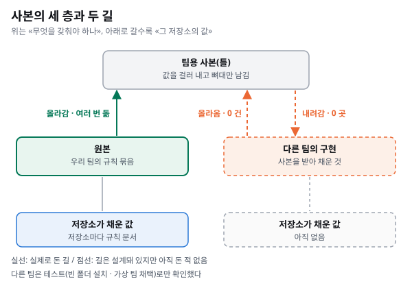
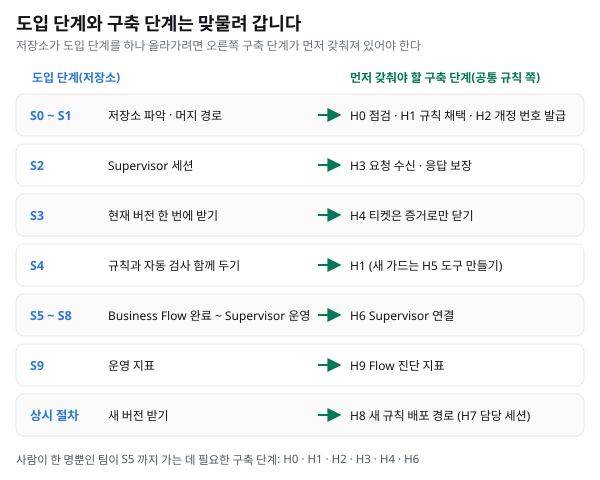

> **함께 읽으면 좋은 글**
> 우리 저장소에 이 규칙을 도입한 순서는 [Business Flow 를 내 저장소에](../business-flow-adoption-guide/) 에 있습니다. 이 글은 그 규칙을 **다른 팀이 받아 쓸 수 있게 만든 팀용 템플릿** 이 무엇이고, 어떻게 반영되고 배포되는지를 다룹니다. 앞 글을 읽지 않아도 이 글만으로 이해되게 썼습니다.

## 한 줄로

우리 팀 저장소들이 실제로 쓰는 규칙 묶음이 있습니다. 이 글에서는 이것을 **원본** 이라고 부릅니다. **원본에서 우리 팀 고유 내용을 빼고 구조만 남긴 팀용 템플릿을 만들었습니다.** 다른 팀은 템플릿을 받아 자기 저장소에 맞는 내용으로 채웁니다. 받는 팀은 도구를 설치한 뒤 공통 규칙 쪽(아래)을 먼저 만들고, 그다음 각 저장소에 규칙을 채웁니다. 쓰다가 나아진 것은 템플릿에 반영하고, 템플릿의 새 버전은 각 팀에 배포하도록 설계했습니다.

우리 팀에는 공통 규칙(여러 저장소가 따르는 팀 공통 규칙 문서)을 모아 두는 중앙 저장소가 있고, 그 저장소에서 규칙을 고치고 각 저장소에 배포하는 세션이 있습니다. 규칙 문서 자체가 아니라 이 저장소와 세션을 묶어 **공통 규칙 쪽(harness)** 이라고 부릅니다. 템플릿을 받는 팀에는 이것이 아직 없습니다. 그래서 받는 팀은 저장소에 규칙을 넣기 전에 공통 규칙 쪽부터 만들어야 하고, 템플릿에는 그 순서도 들어 있습니다.

현재 어디까지 왔는지도 먼저 적어 둡니다. **원본에서 템플릿으로 반영한 일은 여러 번 있었습니다. 같은 조직의 다른 두 팀(기획 · 디자인)이 템플릿을 시범으로 받아 써 봤고, 그 피드백이 템플릿을 다시 짜게 했습니다.** 다만 지금 두 팀의 저장소는 템플릿이 아니라 원본에서 직접 받은 규칙을 씁니다. 이 글은 성공 사례가 아니라 설계와 시범 결과, 그리고 비어 있는 곳의 기록입니다.



## 왜 팀용 템플릿이 따로 필요했나

원본에는 우리 팀 고유 내용이 곳곳에 들어 있습니다. 저장소 이름, 세션 이름, 티켓 번호, 날짜, 사람, 파일 경로 같은 것입니다. 그대로 건네면 받는 팀은 다른 팀의 사정을 지우는 일부터 해야 합니다. 저장소가 무엇을 만드는지, 어떻게 일하는지도 다릅니다. 우리 저장소는 앱 · 웹 · 서버 · 인프라이지만 받는 팀은 디자인 시스템이나 기획 문서 저장소일 수 있습니다.

그래서 템플릿은 **무엇을 갖춰야 하나, 어떤 순서로 만드나, 무엇을 완료 기준으로 보나** 만 줍니다. 저장소 이름, 경로, 세션 이름, 브랜치, 모델 같은 내용은 받는 팀이 채웁니다. 저장소 하나 안에서 «무엇을 갖출지(구조)» 와 «저장소마다 채우는 것(내용)» 을 나누듯, **팀 사이에서도 구조(템플릿)와 내용(각 팀이 채움)을 나눈 것**입니다.

템플릿에 든 것을 구성 요소별로 정리하면 아래와 같습니다.

| 구성 요소 | 들어 있는 것 |
| --- | --- |
| 규칙 문서의 구조 | 열일곱 항목의 작업 흐름 표(예: 흐름 층 · 완료 기준 · 실환경 검증), 저장소가 최소로 갖출 규칙, Supervisor · 티켓 · 브랜치 운영 규칙 |
| 단계 | 저장소 하나가 밟는 도입 단계(S0 ~ S9)와, 공통 규칙 쪽이 먼저 갖춰야 하는 구축 단계(H0 ~ H9). 아래 «도입 단계는 같고, 템플릿이 더한 것» 에서 설명합니다 |
| 공통 규칙 쪽의 구조 | 공통 규칙 쪽의 역할 정의 · 절차, 업무별 담당 세션의 구조 |
| 도구 | 기록(레지스트리) · 요청을 받는 도구 · 점검 스크립트 같은 관리 도구, 로컬 CI 와 티켓(저장소와 공통 규칙 쪽이 요청을 주고받는 수단) 같은 공용 시스템 |
| 스킬 · 훅 | Business Flow 를 실행하는 필수 스킬 열한 개, 규칙을 자동으로 검사하는 Claude Code 훅 묶음 |
| 설치 | 처음 만드는 순서, 설치 스크립트, 어디까지 왔는지 알려 주는 점검 스크립트(`scripts/doctor.sh`), 받은 규칙이 그대로인지 보는 스크립트(`scripts/canon-lock.sh check`), 필수 스킬 점검(`scripts/check-skills.sh`) |

## 원본에서 무엇을 뺐나

원본의 새 버전을 템플릿으로 옮길 때 가져오는 것과 빼는 것을 정해 두었습니다. 빼야 할 내용을 찾는 패턴(필터링 패턴)을 두고, 그 패턴에 걸리는 내용이 템플릿에 남아 있으면 실패하는 테스트를 거쳐 옮깁니다. 이 글에서는 이렇게 빼는 일을 필터링이라고 부릅니다.

- **빼는 것:** 날짜, 내부 티켓과 결정 번호, 저장소 · 사람 · 세션 이름, 사용자가 한 말의 원문, 절대 경로, 조직 이름, 앱 ID, 내부 주소.
- **바꾸는 것:** 저장소 이름은 일반 이름(`app-a` · `svc-a` · `web-a`)으로, 테스트용 날짜는 가짜 연도로, 경로는 홈 폴더 기준으로, 서비스 라벨의 접두어는 설정 값으로 바꿉니다. 규칙이 생긴 사건의 경위는 «왜 이 규칙이 필요한가» 한 줄로 줄입니다. 같은 저장소는 코드 · 테스트 · 문서에서 같은 일반 이름이어야 합니다.
- **남기는 것:** 규칙, 단계, 명령, 로직, 원본이 버전을 매겨 정식으로 배포한 규칙의 번호, 도구가 실제로 쓰는 명령 이름.

규칙 하나를 템플릿에 넣을지는 아래 기준으로 나눴습니다.

| 규칙의 상태 | 처리 |
| --- | --- |
| 원본이 정식으로 배포했고, 우리 팀 고유 내용을 빼도 뜻이 통함 | 넣습니다 |
| 정식 배포 전이지만 현재 원본에서 적용 중 | 바로 넣고, 정식 배포를 기다린다는 뜻으로 «원본 대기 규칙(다음 버전)» 표시를 붙입니다 |
| 원본이 시행 시점을 뒤로 미뤘거나 아직 초안 | 미룹니다 |
| 사내 접근 정보 · 제3자 저작물 · 개인용 · 한 저장소에만 맞음 | 뺍니다 |

빼거나 미룬 것은 목록에 까닭을 한 줄씩 남깁니다.

### 우리 팀 고유 내용이 템플릿에 섞여 들어간 일이 실제로 있었습니다

원본의 새 버전을 템플릿으로 옮기다가 빼야 할 내용이 템플릿에 남은 일이 있었습니다. 어떤 것이었는지만 적으면 아래와 같습니다.

| 섞여 들어간 것 | 어떻게 찾고 막았나 |
| --- | --- |
| 원본의 티켓 번호와 담당 세션 이름이 필터링 패턴 밖에 있어서 테스트가 통과함 | 설치 결과를 사람이 읽어 확인하는 설치 점검에서 반려되어 찾았습니다. 패턴을 넓히고, 그런 내용을 일부러 넣으면 실패하고 허용된 내용은 통과하는지 보는 테스트를 만들었습니다 |
| 새 도구 코드 주석에 들어 있던 내부 티켓 번호 | 독립 검수가 찾아 같은 버전 안에서 지웠습니다 |
| 작업 중 만든 계획서와 설계 문서가 설치 파일에 함께 들어감 | 이런 문서 6 개를 일부러 넣어 두고, 설치 결과에 0 개가 남는지 확인하는 대조 테스트를 더했습니다 |

앞의 둘(설치 점검 · 독립 검수)은 사람이 읽는 검토가 먼저 찾았습니다. 표에 적은 처리와 별도로, 세 건 모두 그 뒤에 같은 꼴을 막는 테스트가 하나씩 늘었습니다. 필터링을 테스트가 처음부터 다 지켜 준다고 쓸 수는 없습니다. 섞여 들어가는 꼴을 찾을 때마다 테스트가 늘어난 것이 실제 경과입니다.

## 도입 단계는 같고, 템플릿이 더한 것

템플릿은 저장소 하나가 순서대로 밟는 도입 단계를 S0 ~ S9 로 적습니다. S0 저장소 파악, S1 머지 경로, S2 Supervisor 세션, S3 현재 버전 받기로 시작해 S9 운영 지표까지 갑니다(전체 짝은 아래 표). 앞 글은 그중 S0 ~ S5 만 다뤘는데, 확인해 보니 **원본에도 S6 ~ S9 와 상시 절차(단계가 아니라 새 버전이 나올 때마다 되풀이하는 절차로, 아래 배포 경로를 각 팀 쪽에서 밟는 일)가 있습니다.** 여러 작업이 동시에 돌거나 공유 자원이 생겨 필요가 생겼을 때만 여는 단계라서 앞 글이 다루지 않았을 뿐입니다. 템플릿에만 있는 도입 단계는 없습니다.

공통 규칙 쪽이 밟는 단계는 H0 ~ H9 로 따로 적고 **구축 단계** 라고 부릅니다. 이 글에서 S 는 저장소의 도입 단계, H 는 공통 규칙 쪽의 구축 단계입니다.

실제로 다른 점은 아래와 같습니다.

1. **단계 구성은 같고, 단계 안에 템플릿이 더한 내용이 있습니다.** S1 에는 구조 규칙 첫 버전과 규칙 이행 표(규칙마다 저장소에서 지켜지는지 표시하는 표), 전체 점검 알림이 들어 있습니다. 원본의 도입 단계 문서에는 없던 것입니다. S0 · S2 · S3 · S5 · S9 에도 템플릿이 더하거나 고친 줄이 있고, 템플릿은 그런 줄에 «정리» 표시를 붙입니다.
2. **이름이 몇 개 다릅니다.** 성능 보고서가 «Flow 진단 보고» 로 바뀌었고, S9 는 원본 지표 대신 Flow 진단 지표 열두 개를 씁니다. 지표는 품질(단계가 명세대로 했나) · 성능(정한 시간과 순서대로 흘렀나) · 효과(노린 결과가 났나) · 효율(그 결과에 든 비용이 작은가) 네 축에 셋씩 나뉩니다. 어느 지표든 «규칙이 예측한 흔적과 실제 흔적의 차이» 를 봅니다.
3. **공통 규칙 쪽의 구축 단계(H0 ~ H9)는 템플릿에만 있습니다.** 이 글에서 가장 큰 차이입니다. 원본에서는 이 단계가 문서 하나로 정리돼 있지 않았습니다. 원본의 변경 이력을 거꾸로 따라가며 «어떤 필요가 생겼을 때 무엇을 만들었나» 를 단계로 다시 묶은 것입니다.

### 받는 팀은 공통 규칙 쪽부터 만들어야 합니다

예를 들어 저장소가 Supervisor 를 열면(S2), Supervisor 가 낸 티켓을 받아 처리하고 응답을 돌려줄 곳이 있어야 합니다. 원본에서는 그곳이 공통 규칙 쪽(harness)이고 처음부터 있었습니다. 그래서 우리 저장소들은 도입 단계만 밟으면 됐습니다. 처음 받는 팀에는 이것이 없습니다. 요청 수신과 응답 보장(H3)이 없는 채로 Supervisor 를 열면, 받아 줄 곳이 없어 요청만 쌓입니다.

그래서 템플릿에는 공통 규칙 쪽이 밟는 구축 단계(H0 ~ H9)가 따로 있습니다. 저장소가 다음 도입 단계로 넘어가려면, 그 단계에 필요한 구축 단계가 먼저 끝나 있어야 합니다. S2 를 하려면 H3 이 먼저 끝나 있어야 하는 식입니다.



| 도입 단계(저장소) | 먼저 끝나 있어야 할 구축 단계(공통 규칙 쪽) |
| --- | --- |
| S0 ~ S1 저장소 파악 · 머지 경로 | H0 점검(이 팀에 규칙이 이미 있는지 보고 «규칙 없음» 판정까지) · H1 받은 규칙 채택 · H2 개정 번호 발급(규칙을 고칠 때마다 개정 번호를 받는 곳) |
| S2 Supervisor 세션 | H3 요청 수신 · 응답 보장 |
| S3 현재 버전 한 번에 받기 | H4 티켓은 증거로만 닫기 |
| S4 규칙과 자동 검사를 함께 두기 | H1 (새 가드를 만들면 H5 도구 만들기) |
| S5 ~ S8 Business Flow 완료 ~ Supervisor 운영 | H6 Supervisor 연결 |
| S9 운영 지표 | H9 Flow 진단 지표 |
| 상시 절차 새 버전 받기 | H8 새 규칙 배포 경로 · 담당 세션 흐름 (H7 담당 세션 나누기) |

사람이 한 명뿐인 팀이 S5 까지 가는 데 꼭 필요한 구축 단계는 **H0 · H1 · H2 · H3 · H4 · H6** 입니다. 도구 만들기(H5)는 새 가드를 만들 때만, 담당 세션 나누기(H7)와 새 규칙 배포 경로(H8), 지표(H9)는 필요가 생길 때까지 미룹니다. 특히 H7 은 공통 규칙 쪽 세션 하나가 요청 접수 · 판정 · 전달을 감당하지 못할 때만 합니다. 한 사람이 여러 역할을 맡을 때도 점검 항목은 건너뛰지 않습니다. 다만 다른 사람이 따로 봐야 하는 항목(판정 · 심사)을 혼자 할 때는 «자기 검토» 라고 표시합니다. 자기가 자기를 심사하면서 독립 심사인 척하지 않기 위해서입니다.

## 개선은 템플릿으로, 새 버전은 각 팀으로

템플릿은 원본에서 나왔지만, 템플릿이 생긴 뒤로는 원본도 템플릿의 구조에 우리 팀 내용을 채운 한 팀으로 봅니다. 다른 팀도 템플릿을 받으면 같은 처지가 됩니다. 그래서 템플릿을 오가는 경로는 아래와 같습니다.

- **반영 경로** — 원본이나 다른 팀에서 쓰다가 나아진 것을 템플릿에 넣습니다. 원본에서는 여러 번 돌았고, 시범으로 받아 본 두 팀의 피드백도 이 경로로 들어왔습니다.
- **배포 경로** — 템플릿의 새 버전을 각 팀에 보냅니다. 두 팀이 시범으로 받아 봤지만, 템플릿의 새 버전을 이 경로로 받아 운영하는 팀은 아직 없습니다.

### 반영 경로 — 원본 · 다른 팀에서 템플릿으로

템플릿을 고치는 사람은 템플릿 저장소의 소유자 한 명입니다. 나머지는 결함 · 개선 후보를 템플릿 저장소의 issue 로 올리는데, issue 양식이 있고 세션이 본문을 쓰면 등록은 사람이 합니다. 오탈자 한 글자도 같습니다. 올릴 때는 템플릿의 점검 기준(체크리스트)에서 어느 항목에 어긋나는지를 반드시 달고, 기준을 대지 못하면 그 자체를 issue 후보로 남깁니다. 원본에서 나아진 것은 아래 순서로 템플릿에 들어옵니다. 표의 «사용자» 는 AI 세션에 일을 시키고 결정하는 사람, «템플릿 소유자» 는 템플릿 저장소를 관리하는 사람이고, «…담당» 은 그 일을 맡은 AI 세션입니다. 다른 팀의 후보는 2 · 3 단계(일반화 판정 · 결정)를 템플릿 소유자가 직접 정합니다. 고칠 때까지 그 팀은 자기 규칙 문서에 «issue 대기» 와 issue 주소를 적고 일을 잇습니다.

| 단계 | 누가 | 끝났다는 표시 |
| --- | --- | --- |
| 1 후보 — 실제로 써 보고 나아진 것(근거 커밋 · 점검 기준 항목) | 그 팀의 공통 규칙 쪽 | 후보 문서 |
| 2 일반화 판정 — 다른 팀에서도 쓸 수 있는지 판단(고유 내용 0 · 실제 근거 있음 · 템플릿의 어느 위치인지) | 원본 후보면 원본의 규칙 관리 담당, 다른 팀 후보면 템플릿 소유자 | 판정 · 고유 내용을 뺀 정리 문서 |
| 3 사용자 결정 | 사용자 | 답 원문 |
| 4 템플릿 개정 — 필터링 테스트를 거쳐 쓰고 새 버전으로 냄 | 템플릿 담당 세션 · 템플릿 소유자 | 새 버전 · lock 파일(파일마다 해시를 적은 파일) |
| 5 새 버전 받기 — 배포 경로로 다시 | 각 팀 | 대조표(바뀐 규칙마다 반영 상태를 적는 표) |

이 경로는 **실제로 여러 번 돌았습니다.** 원본의 규칙을 템플릿에 넣은 일을 변경 이력으로 세면 손으로 일곱 번, 새 버전을 가져오는 전용 절차로 한 번입니다. 세는 기준을 바꿔 커밋 제목을 보면 «승격»(이 글에서 «반영» 이라 부르는 일의 예전 이름)이 붙은 커밋이 여섯 개 있고, 모두 원본에서 템플릿으로 반영한 것입니다. 앞 절의 필터링이 이 경로 위에서 일어나는 일입니다. <!-- wording-ok -->

**다른 팀에서 온 개선도 있습니다.** 시범으로 받아 본 디자인 팀은 설치 피드백 문서를, 기획 팀은 적용 과정의 개선점 15 항을 묶어 템플릿 관리자에게 보냈습니다. 템플릿은 이 피드백으로 저장소 종류 · 도입 단계 · Supervisor 를 여는 순서를 다시 짰습니다. 다만 issue 양식이 아니라 묶음 문서로 왔습니다. 현재는 원본이 가장 앞서 있어서 반영할 후보도 대부분 원본에서 나옵니다.

### 배포 경로 — 템플릿에서 각 팀으로

템플릿에 새 버전이 나오면 받는 팀은 아래 순서로 반영합니다.

1. **받습니다.** 파일 이름의 canon 은 공통 규칙의 영어 이름입니다. 새 버전은 사람이 터미널에서 `scripts/update-canon.sh` 로 받습니다. 받은 버전은 lock 파일(`CANON.lock`, 버전과 파일별 sha256), 각 저장소 규칙 문서 맨 위, 착수 알림(저장소가 도입을 시작할 때 공통 규칙 쪽에 보내는 알림)에 같은 값으로 적힙니다. 적힌 버전이 새 버전과 같으면 끝입니다.
2. **차이를 확인합니다.** 변경 요약에는 버전마다 개정 번호 · 위치 · 요지 · 행동 변경만 적혀 있고, 번호 하나가 대조표의 한 행입니다.
3. **반영합니다.** 바뀐 규칙마다 자기 저장소에 «있다 · 일부 · 없다 · 해당 없음» 중 하나로 표시하고, 그 저장소의 개정 절차로 고쳐 통합 브랜치(그 팀이 머지하는 기본 브랜치)에 머지한 뒤 버전을 새 버전으로 바꿉니다.

위 «있다 · 일부 · 없다 · 해당 없음» 은 규칙 하나의 상태이고, 저장소 전체의 상태는 아래처럼 나눕니다.

- **받음** — 버전 번호만 새 버전과 같습니다.
- **맞음** — 버전이 새 버전이고, 규칙 이행 표에 빈 줄이 0 이고, 확인 스크립트가 통과합니다. «맞음» 은 이 조건이 모두 맞을 때만 인정합니다.

팀이 «받았다» 고 회신해도 반영이 끝난 것으로 보지 않고, «맞음» 의 조건을 스크립트로 확인합니다.

받은 팀에는 파일이 두 종류 있습니다. **템플릿 저장소에서 가져온 규칙 파일은 읽기 전용이고**, 각 저장소의 규칙 문서는 그 팀이 직접 고칩니다. 위 3 에서 개정 절차로 고치는 것은 규칙 문서 쪽입니다. 템플릿 파일에 고칠 것이 있으면 앞의 반영 경로로 issue 를 올립니다. 파일마다 해시(sha256)를 적어 둔 lock 파일이 있습니다. 훅이 세션의 쓰기를 막고, `scripts/canon-lock.sh check` 가 어긋남을 찾으면 ✗ 를 냅니다. 버전은 위 세 곳에 같은 값으로 적고, 따로 된 버전 기록 파일은 두지 않습니다. 팀만의 차이는 템플릿 파일이 아니라, 각 저장소의 규칙 문서나 템플릿 밖에 팀이 따로 둔 규칙 폴더(예: `canon-local/`)에 적습니다.

팀마다 달라도 되는 것과 같아야 하는 것도 나눠 두었습니다.

- **달라도 되는 것:** 폴더 위치, 세션 이름, 담당 세션을 몇 개 여는지, 보고 주기, 상태 확인 간격, 세션에 알림을 보내는 방법, 저장소 목록, 저장소별 내용, 팀이 관리하는 규칙 폴더, 기록(레지스트리) 안의 내용.
- **같아야 하는 것:** 규칙 버전과 해시, 필수 스킬과 필수 훅, 단계마다의 완료 기준, Flow 진단 지표의 정의와 산식.

이 경로는 **시범까지만 돌았습니다.** 디자인 팀 저장소는 시범 당시 S0 ~ S3 을 충족하고 S4 를 진행했습니다. 기획 팀 저장소는 S1 을 충족하고 Business Flow 를 진행하던 중이었습니다(S2 는 아직). 지금 두 저장소는 원본에서 직접 받은 규칙을 쓰고 있어서, 템플릿의 새 버전을 이 경로로 받아 운영하는 팀은 아직 없습니다. 같은 조직의 콘텐츠 저장소는 이 두 팀과 달리, 첫 설치 때 템플릿의 도입 단계(S0 → S1)만 따랐습니다. 규칙 본문과 그 뒤의 새 버전은 원본에서 받았습니다.

## 받는 팀이 처음 하는 일

처음 받는 팀은 아래 순서로 만듭니다.

1. 템플릿 저장소를 받습니다(clone).
2. Claude Code 의 전역 지침 파일(`~/.claude/CLAUDE.md`)을 템플릿(`templates/global/CLAUDE.md`)의 자리표시대로 채웁니다. 언어 · 조직 · 공통 규칙 쪽 위치 · 버전 · 빌드 도구 · 템플릿 저장소 위치 같은 것입니다. `scripts/setup-machine.sh --guide=apply` 는 이 파일에 표시된 구역 하나만 넣고(기본값 `--guide=diff` 는 차이만 보여 주고 쓰지 않습니다), 나머지는 사람이 채웁니다.
3. 스킬을 복사합니다. 템플릿이 전역 설정을 직접 바꾸지는 않습니다.
4. 티켓 시스템과 로컬 CI 를 설치하고 필수 훅을 켭니다(공통 규칙 쪽보다 먼저인 까닭은 아래).
5. 설치 스크립트로 공통 규칙 쪽 저장소를 만듭니다. 그 폴더에서 연 세션이 공통 규칙 쪽 세션입니다.
6. 공통 규칙 쪽 세션을 세션 명부(어느 세션이 어떤 역할을 맡는지 적는 목록)에 올립니다. 처음에는 이 세션이 저장소의 Supervisor 역할까지 맡고, S2 에서 저장소의 Supervisor 세션이 열리면 그 일을 넘깁니다.
7. 구축 단계 H0 에서 시작해 첫 저장소를 도입 단계 S0 에 올립니다.
8. 그 뒤로는 앞의 «도입 단계 · 구축 단계» 표의 짝대로, 도입 단계를 밟기 전에 그 단계에 필요한 구축 단계를 먼저 끝냅니다. 다음 단계로 넘어갈 때마다 전역 지침에 그 단계의 항목을 넣습니다.

티켓 시스템을 공통 규칙 쪽 저장소보다 먼저 설치하는 것은 서로 기다리는 순서를 피하려는 것입니다. 공통 규칙 쪽과 각 저장소가 주고받는 요청은 티켓으로 오가므로, 티켓 저장소가 있어야 첫 요청을 쓸 수 있습니다. 반면 공통 규칙 쪽이 저장소의 규칙을 점검하는 것은 규칙이 생긴 뒤(S1)입니다. 그래서 요청을 주고받을 티켓 쪽을 먼저 둡니다.

어디까지 왔는지는 `scripts/doctor.sh` 를 돌리면 알 수 있습니다. 읽기만 하는 스크립트이고, 처음 나오는 ✗ 가 다음 할 일입니다. 출력은 아래와 같은 꼴입니다(N 은 남은 자리표시 수).

```text
  ✓ 필수 스킬
  ✗ 전역 지침 ~/.claude/CLAUDE.md
다음 할 일: templates/global/CLAUDE.md 를 채워 ~/.claude/CLAUDE.md 로 둔다(남은 자리표시 N)
```

모든 항목이 서면 «여기까지 모두 섰다.» 가 나옵니다.

규칙 문서를 처음 설치하는 절차도 템플릿에 문서로 들어 있습니다. S1 · S3 · S4 를 밟으면 그 안에서 실행되는 하위 절차라서, 따로 따르지 않아도 됩니다. 원본 쪽 기록을 보면, 최근 원본에 들어온 새 저장소 다섯 곳은 단계 이름(S1 · S3 · S4) 대신 이 설치 절차의 이름으로 남아 있습니다.

## 아직 안 된 것

- **템플릿으로 운영하는 다른 팀은 아직 없습니다.** 기획 · 디자인 두 팀의 시범 말고 있는 것은 빈 홈 폴더에서 돌리는 설치 테스트, 가상의 팀이 템플릿만 보고 처음 받아 보는 상황을 꾸민 채택 테스트, 템플릿 자신의 규칙 설치입니다. 테스트 기록은 도입 사례로 세지 않습니다.
- 채택 테스트에서 막힌 곳은 회차마다 8 → 0 → 0 → 3 개였습니다. 첫 회차 8 개 가운데 7 개는 템플릿에서 고쳤고, 1 개는 원본의 판정을 기다리는 것이라 합격 판정에서 뺐습니다. 마지막 회차의 3 개도 고쳤습니다. 마지막 채택 테스트 뒤로 템플릿의 버전이 더 올랐지만 그 뒤의 결과 파일은 없습니다. 가상 시나리오라서 실제 팀이 막힐 곳과 같다고 단정할 수도 없습니다.
- 템플릿이 직접 만든 디자인 시스템용 · 기획 문서용 규칙은 **각각 실제로 적용해 본 저장소가 한 곳**뿐입니다. 이 한 곳이 위 두 팀의 시범 저장소입니다. 두 번째 저장소에 적용해 본 뒤에 확정 규칙으로 바꿉니다. 서버용과 웹용은 원본에서 받은 그대로이고, 안드로이드 · 배포 차트 · CI 서버 · 콘텐츠용은 항목만 있습니다.
- 템플릿을 고치는 사람이 소유자 한 명이라서, 템플릿을 쓰는 팀이 늘면 여기가 병목이 될 수 있다고 봅니다. 다른 사람이 낸 변경을 받는 경로는 «뒤에 열 수 있다» 고만 적혀 있고 아직 열려 있지 않습니다.

## 정리

- 팀용 템플릿은 원본에서 **우리 팀 고유 내용을 빼고 구조만 남긴 것**입니다. 무엇을 갖춰야 하나 · 어떤 순서로 만드나 · 무엇을 완료 기준으로 보나만 주고, 내용은 받는 팀이 채웁니다.
- 받는 팀이 처음 하는 일은 **공통 규칙 쪽(harness)부터 만드는 것**입니다. 도구와 훅을 설치하고 공통 규칙 쪽 저장소를 만든 뒤, 구축 단계 H0 에서 시작해 첫 저장소를 도입 단계 S0 에 올립니다.
- 도입 단계는 원본과 템플릿이 같습니다. 템플릿이 더한 것은 공통 규칙 쪽의 구축 단계입니다.
- 필터링은 한 번에 끝나지 않았습니다. 섞여 들어간 꼴을 찾을 때마다 테스트를 하나씩 더했습니다.
- 반영 경로는 원본에서 여러 번 돌았고, 다른 두 팀의 시범 피드백도 템플릿을 바꿨습니다. **템플릿의 새 버전을 배포 경로로 받아 운영하는 팀은 아직 없고**, 이 글은 그 기록이 생기면 다시 고칩니다.
