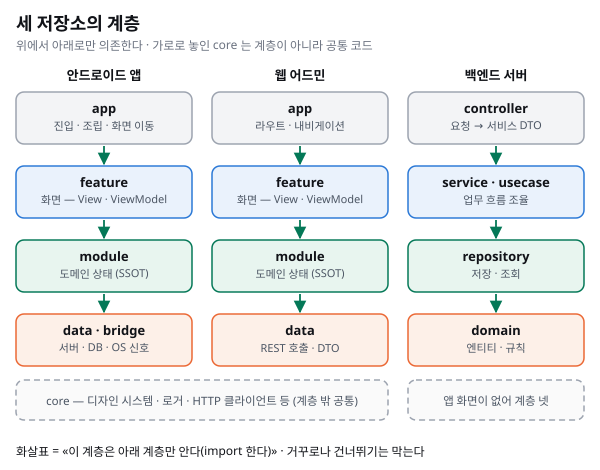
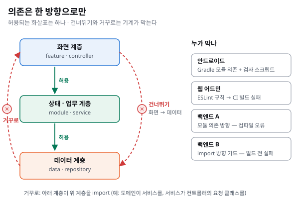
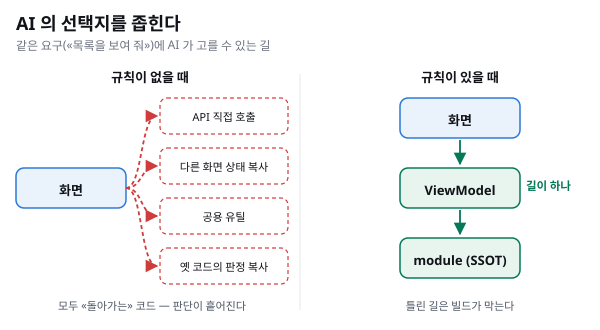

## 한 줄로

**AI 는 코드를 빨리, 많이 씁니다. 그래서 «어디에, 어떤 모양으로 써야 하는지» 를 정해 두는 아키텍처가 더 중요해졌습니다.** 아키텍처는 사람만 읽는 설계 문서가 아니라, AI 가 고를 수 있는 선택지를 좁히는 장치입니다.

## 그럴듯하지만 구조가 없는 코드

우리 팀은 지금 코드의 상당 부분을 AI 에이전트와 함께 씁니다. 백엔드 저장소 하나만 봐도, AI 가 공동 작성자로 들어간 커밋이 전체 커밋의 절반을 넘습니다.

AI 가 쓰는 코드에는 공통된 위험이 있습니다. **돌아가고, 테스트도 통과하고, 읽어 보면 그럴듯한데, 구조가 없습니다.** 이번 화면에만 맞춘 판정, 비슷한 기능에서 가져온 옛 규칙, 경계를 넘어 재사용한 DTO 같은 것입니다. 하나하나는 작지만, AI 는 이런 코드를 사람보다 훨씬 빠르게 늘립니다. 흔히 «슬롭(slop) 코드» 라고 부르는 것입니다.

켄트 벡은 AI 와 함께 코딩하는 방식을 둘로 나눴습니다. 동작만 맞으면 코드는 신경 쓰지 않는 «바이브 코딩» 과, 코드 · 복잡도 · 테스트를 계속 신경 쓰는 «증강 코딩(augmented coding)» 입니다. 그는 직접 AI 와 라이브러리를 만들며 TDD 와 코드 정리 규칙을 AI 에게 쥐여 줬는데, 그래도 코드 품질은 아쉬웠다고 털어놓습니다.([Augmented Coding: Beyond the Vibes](https://newsletter.kentbeck.com/p/augmented-coding-beyond-the-vibes), 2025)

우리의 결론도 같습니다. **AI 에게 «잘 써 줘» 라고 말하는 것만으로는 부족합니다.** 잘못 쓸 자리를 구조로 없애야 합니다.

## 아키텍처는 원래 «다음 변경» 을 위한 것

마틴 파울러는 사용자가 볼 수 있는 외부 품질과 달리, 아키텍처 · 코드 구조 같은 내부 품질은 **다음 변경을 싸게 만드는 것** 이라고 설명합니다. 그래서 내부 품질에는 «품질과 비용을 맞바꾼다» 는 말이 성립하지 않는다고 합니다. 그의 표현으로는 "The “cost” of high internal quality software is negative." 입니다.([Is High Quality Software Worth the Cost?](https://martinfowler.com/articles/is-quality-worth-cost.html), 2019)

AI 가 코드를 쓰면 «다음 변경» 이 훨씬 자주, 훨씬 많이 옵니다. 내부 품질이 낮으면 그 비용도 같은 속도로 쌓입니다. AI 시대에 아키텍처가 더 중요해진 이유는 이것 하나로 충분합니다.

## 계층(layer) — 코드를 가로로 나눈다

아키텍처의 가장 기본은 **계층** 입니다. 코드를 하는 일에 따라 가로로 여러 층으로 나누고, 층마다 맡는 일을 정합니다. 우리 저장소 세 곳의 계층은 이렇습니다.

이름은 저장소마다 다르지만, 층마다 하는 일은 비슷합니다.

| 층 | 앱(안드로이드 · 웹) | 백엔드 | 맡는 일 |
| --- | --- | --- | --- |
| 맨 위 | app | controller | 바깥과 만나는 곳. 앱은 화면을 띄우고 이동하며, 서버는 요청을 받아 서비스가 쓸 DTO 로 바꿉니다 |
| 둘째 | feature | service · usecase | 화면 하나, 또는 업무 흐름 하나를 조율합니다 |
| 셋째 | module | repository | 앱은 도메인 상태를 단일 진실 원천(SSOT)으로 관리하고, 서버는 저장 · 조회를 맡습니다 |
| 맨 아래 | data · bridge | domain | 앱은 서버 · DB · OS 와 실제로 주고받고, 서버는 엔티티와 도메인 규칙을 둡니다 |

앱의 **core** 는 계층이 아닙니다. 디자인 시스템 · 로거 · HTTP 클라이언트처럼 여러 층이 같이 쓰는 공통 코드라서, 층 순서 밖에 가로로 둡니다. 대신 core 안의 코드가 실제로 서버나 DB 와 주고받는다면, 그 코드는 경로가 core 여도 데이터 층 몫으로 봅니다. 경로가 아니라 하는 일로 판정합니다.

### 의존은 한 방향으로만

계층을 나누는 것보다 중요한 것은 **층 사이의 의존 방향** 입니다. 여기서 «의존한다» 는 «import 해서 쓴다», 곧 «안다» 는 뜻입니다.

규칙은 세 줄입니다.

- **허용 — 바로 아래 층만 안다.** 화면은 상태 · 업무 층을 부르고, 상태 · 업무 층은 데이터 층을 부릅니다.
- **금지 — 건너뛰기.** 화면이 데이터 층(API · DB)을 바로 부르지 않습니다. 건너뛰면 «이 데이터를 어떻게 다룰지» 라는 판단이 화면마다 따로 생깁니다. 같은 질문에 답하는 코드가 여러 벌이 되는 출발점입니다.
- **금지 — 거꾸로.** 아래 층이 위 층을 import 하지 않습니다. 예를 들어 도메인이 서비스를, 서비스가 컨트롤러의 요청 클래스를 알면 안 됩니다. 거꾸로 알면, 화면이나 API 를 조금 바꿨는데 가장 안쪽의 도메인 코드까지 같이 고쳐야 합니다.

방향을 하나로 정하면 **바꿀 때 영향이 어디까지 번지는지** 가 정해집니다. 위 층을 바꾸면 그 층만 고치면 되고, 아래 층을 바꿀 때만 위를 확인하면 됩니다. 사람에게도 중요하지만, 고칠 범위를 스스로 판단하기 어려운 AI 에게는 더 중요합니다.

그리고 이 방향은 **사람이 기억해서 지키는 것이 아니라 기계가 막습니다.** 안드로이드는 Gradle 모듈 의존과 검사 스크립트가, 웹 어드민은 ESLint 규칙과 그 경고를 오류로 바꾸는 CI 빌드가, 백엔드는 모듈 의존 방향(어기면 컴파일이 안 됨)이나 import 방향 가드(어기면 빌드 전에 실패)가 막습니다.

## 아키텍처가 AI 에게 하는 일 — 선택지를 좁힌다

사람 개발자는 애매한 곳에서 멈추고 묻습니다. AI 는 멈추지 않고 그럴듯한 쪽을 고릅니다. 그래서 아키텍처가 AI 에게 하는 일은 **«그럴듯한 선택지» 자체를 줄이는 것** 입니다. 우리 저장소에서 이것은 세 가지 모양으로 나타났습니다.

같은 «목록을 보여 줘» 라는 요구에도, 규칙이 없으면 AI 앞에는 돌아가는 길이 여러 개 열려 있습니다. 어느 길을 골라도 화면은 뜨고 테스트도 통과합니다. 문제는 그 판단이 화면마다 흩어진다는 것입니다. 규칙이 있으면 길은 하나만 남고, 다른 길은 빌드가 막습니다.

### 1. 계층마다 «모르는 것» 을 정한다

앞에서 본 의존 방향을 한 걸음 더 들어가면, 계층마다 **무엇을 모르는지** 가 됩니다. 안드로이드와 웹 어드민은 이것을 규칙으로 정해 두었습니다. 예를 들어 화면(feature)은 데이터 계층을 모르고, View 는 module 의 값을 모르며, Store 를 부를 수 있는 곳은 ViewModel 하나입니다.

이렇게 정해 두면 AI 가 «화면에서 바로 API 를 부르는» 쪽을 고를 수 없습니다. 판단이 들어갈 자리가 처음부터 한 곳으로 정해져 있기 때문입니다. 자세한 내용은 [안드로이드 아키텍처 ①](../android-architecture-1-one-truth/) 과 [웹 어드민 아키텍처 ①](../web-admin-architecture-1-structure/) 에 썼습니다.

### 2. 한 질문에는 답하는 곳을 하나만 둔다

같은 질문(«이 사람이 이 버튼을 눌러도 되나», «지금 연결돼 있나»)에 답하는 코드가 여러 곳에 있으면, AI 는 그중 아무거나 복사해 하나를 더 만듭니다. 그래서 도메인 상태는 단일 진실 원천(SSOT)으로 module 한 곳에서 관리하고, 화면은 그 답을 읽기만 합니다.

웹 어드민 결정 기록에는 이 규칙이 왜 이렇게 엄격한지 사용자의 말이 남아 있습니다. 액션 없이 상태를 바꾸려 하거나, View 에서 조합해 쓰는 일을 AI 가 자주 한다는 것이었습니다. AI 가 자주 하는 실수를 구조가 막게 한 것입니다.

### 3. 만나는 곳의 모양을 정하고, 기계가 지키게 한다

feature 와 feature 가 만나는 곳은 두 가지 모양으로만 정했습니다. 화면을 통째로 끼워 넣거나(`RouteEntry`), 다른 기능을 불러 써서 요청을 보내거나(`Component` + `dispatch`). 모양이 정해지자 어긋난 코드마다 «무엇을, 어느 모양으로 고칠지» 가 바로 나왔습니다.([규격 하나가 판단을 바꾼다](../android-ui-joint-spec/))

그리고 가능한 것은 기계가 지키게 합니다. 규칙 문서는 읽고 지켜야 하지만, AI 는 읽은 규칙도 놓칩니다. 그래서 import 방향은 가드가 막고, 모듈 의존 방향은 컴파일이 막고, 다음 단계로는 타입이 막게 하려 합니다. **규칙이 «기억할 것» 에서 «어길 수 없는 것» 이 될수록, AI 가 만드는 슬롭이 들어갈 자리가 줄어듭니다.**

## 백엔드와 DDD — 전부 믿지만, 아는 만큼 적용한다

백엔드 저장소는 처음부터 DDD 를 바탕으로 설계해 왔습니다. 그리고 지금도 DDD 를 믿습니다. 몇 가지만 골라 믿는 것이 아니라, DDD 가 말하는 생각 전체를 믿습니다. 다만 **모든 것을 한꺼번에 적용하지는 않습니다.**

### 지금 코드에 들어가 있는 것

규칙 문서에는 «기반은 도메인이다» 라고 적혀 있습니다. 지금 코드에 그대로 들어가 있는 것을 몇 가지 꼽으면 이렇습니다.

- **불변식의 경계가 애그리거트의 경계다.** 함께 지켜야 하는 규칙은 함께 묶습니다.
- **엔티티는 직렬화를 모른다.** 엔티티를 그대로 응답으로 내보내지 않습니다. 한 백엔드 저장소는 엔티티를 응답으로 노출하는 곳이 모듈로 나누기 전에도, 지금도 0 입니다.
- **Bounded Context 마다 자기 예외 묶음을 가진다.**

### 한꺼번에 다 적용하지 않는 이유

한때는 교과서대로 다 하려는 집착이 있었습니다. Bounded Context 를 나누고, 애그리거트와 루트 엔티티를 정하고, 그 구조대로 코드를 쪼갰습니다. 그런데 **도메인을 아직 모르는 상태에서 전부 적용하면, 오히려 불합리한 설계가 나옵니다.** 도메인 전문가가 없는 영역일수록 그랬습니다. 업무를 잘 모르는 채로 경계부터 그으니 경계가 실제 업무와 어긋났고, 모델을 이해하기가 더 어려워졌습니다. 그렇게 만든 설계는 나중에 발목을 잡습니다. 그래서 도메인을 아는 만큼만 적용합니다. 이것은 기록이 아니라 제가 겪은 판단입니다.

흔적은 코드에 남아 있습니다.

- 앱용 라이브러리를 두 모듈로 나눴더니 **같은 이름의 타입이 양쪽에** 생겼습니다. 지금 167개이고, 줄여 가는 중입니다.
- 이름은 UseCase 인데 내용은 서비스인 클래스가 있습니다. 규칙 문서가 스스로 «격차» 로 적어 두었습니다.
- 다른 저장소에서는 UseCase 계층을 일부 도메인에만 들였다가, 같은 서비스 안에 «UseCase 를 거치는 길» 과 «리포지토리로 바로 가는 길» 이 섞였습니다. 서비스 구현 70개 중 34개가 리포지토리를 바로 부릅니다.

그래서 지금은 DDD 용어를 우리 말로 번역해 씁니다. 예를 들어 DDD 의 «도메인 서비스» 는 우리 저장소에서 UseCase 계층으로 읽습니다. 코드를 어디에 둘지는 Bounded Context 가 아니라 Gradle 모듈로 판정합니다. 이미 있는 중복은 한 번에 고치지 않고 «알려진 상태» 로 두고 줄여 갑니다.

### 반대로, 넘어가서 비싸진 것

교과서를 고집하는 것만 문제가 아니었습니다. **설명하기 어렵고 논쟁하기 싫어서 넘어간 것** 이 나중에 더 비싸게 돌아왔습니다.

- 한 백엔드 저장소는 계층 경계를 늦게 세웠습니다. 도메인이 서비스를, 서비스가 컨트롤러를 거꾸로 import 하는 곳이 19곳 있었고, 서비스 DTO 의 생성자가 컨트롤러의 요청 클래스를 받기도 했습니다. 결국 한 번에 174개 파일을 고쳤고, 지금은 가드가 막아 0 입니다.
- 다른 저장소는 모듈로 나누기 전, 팩토리가 컨트롤러의 요청 타입을 받았습니다. 모듈 의존 방향이 컴파일에서 막게 되자 이런 코드는 사라졌습니다.
- 여러 화면이 함께 쓰는 저장 경로가 한 번 바뀐 뒤로, 일부 설정 값이 오랫동안 조용히 저장되지 않았습니다.
- locale 하나만 필요한 API 가 사용자 응답 객체를 통째로 돌려주는 곳은 아직 남아 있습니다.

도메인을 모르는 채로 다 적용하는 것도, 설명하기 싫어 넘어가는 것도 답이 아니었습니다. **도메인을 아는 만큼 적용하고, 적용한 것은 기계가 지키게 하는 것** 이 우리가 찾은 자리입니다.

## AI 가 오기 전과 후

AI 에이전트가 코드를 함께 쓰기 시작한 것은 올해 6월 무렵입니다. 그 전의 계층 구조는 사람이 만들었고, 규칙은 대부분 사람이 읽는 문장이었습니다.

AI 가 들어오자 그 문장들의 약점이 바로 드러났습니다. 같은 내용을 세 번 연속 잘못 읽거나, 옛 규칙을 사실처럼 읽고 새 기능에 물려주는 일이 생겼습니다. 사람이라면 한 번 설명하면 됐을 일입니다. 그래서 규칙을 문장에서 가드 · 모듈 경계 · 타입으로 옮기는 일이 빨라졌습니다.

반대로, 규칙이 분명한 곳에서는 AI 가 사람보다 꼼꼼했습니다. 규칙을 글자 그대로 읽고 쓰지 않는 사본만 지우거나, 회귀를 고치면서 «아무 동작도 안 하는 것» 을 잡는 테스트를 함께 넣었습니다. 따로 세어 두지는 않았지만, 규칙이 분명할수록 AI 가 만든 코드를 다시 고치는 일이 줄었다고 느낍니다.

## 정리

- AI 는 코드를 빨리 많이 씁니다. 그래서 **어디에, 어떤 모양으로 쓸지** 를 정하는 아키텍처가 더 중요해졌습니다.
- 아키텍처는 AI 의 선택지를 좁힙니다. 계층마다 모르는 것, 한 질문에 답하는 곳 하나, 만나는 곳의 정해진 모양.
- 규칙은 사람이 읽는 문장보다 **기계가 막는 구조** 일 때 AI 에게 효과가 있습니다.
- 백엔드에서 DDD 는 전체를 믿지만 한꺼번에 다 적용하지는 않습니다. 도메인을 모르는 채로 다 적용하면 불합리한 설계가 나와 나중에 발목을 잡고, 설명하기 싫어 넘어간 것도 비용이 됐습니다.
